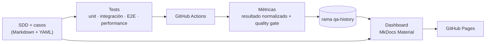

# Farmatodo QA Engineering & Quality Intelligence Platform

Prueba técnica de **Ingeniero de Calidad QA — Farmatodo**, resuelta como un framework de calidad: la especificación va primero, las pruebas están aisladas y priorizadas por riesgo, GitHub Actions las ejecuta y publica un portal con trazabilidad, flaky tests y performance.

[](https://github.com/yoelalmiron1997/farmatodo-qa-test-engineering/actions/workflows/pr-checks.yml)
[](https://github.com/yoelalmiron1997/farmatodo-qa-test-engineering/actions/workflows/functional-tests.yml)
[](https://github.com/yoelalmiron1997/farmatodo-qa-test-engineering/actions/workflows/deploy-pages.yml)
[](LICENSE)

- **Portal de calidad:** https://yoelalmiron1997.github.io/farmatodo-qa-test-engineering/
- **Especificación (SDD):** [`specs/SDD.md`](specs/SDD.md) · casos en [`specs/cases/`](specs/cases/) · requisitos en [`specs/requirements/requirements.yaml`](specs/requirements/requirements.yaml)

## Los cuatro ejercicios

| # | Ejercicio | Resultado |
|---|---|---|
| 1 | Suite automatizada de wordcounter.net (palabras, caracteres, top 3 de Keyword Density) + reporte resumen | Selenium + Pytest + Page Object Model; 20 casos E2E con oráculo independiente; reporte resumen por corrida (`reports/summary.md` / `.html` y Job Summary) |
| 2 | Reporte de fallas de wordcounter.net | 4 defectos confirmados y 2 mejoras, con pasos y capturas: [`docs/bugs/`](docs/bugs/index.md) |
| 3 | 3 problemas de UX en farmatodo.com | Con vista, réplica, evidencia y propuesta: [`docs/ux/`](docs/ux/index.md) |
| 4 | Contador de frecuencia de palabras | Algoritmo propio con la salida exacta del PDF y su complejidad: [`docs/algorithm.md`](docs/algorithm.md) |

## Cómo funciona



- **Especificación como fuente única.** Cada caso (`specs/cases/TC-*.md`) declara requisitos, riesgo (impacto × probabilidad), prioridad, nivel y pasos. El catálogo, la matriz de trazabilidad y las páginas del portal se generan desde ahí, y `qa specs validate` falla ante cualquier inconsistencia.
- **Aislamiento.** Navegador y perfil nuevos por test; orden aleatorio; el oráculo calcula el esperado solo desde el texto de entrada; la suite unitaria corre sin red ni Selenium; un contrato de `import-linter` impide que el núcleo dependa de la infraestructura.
- **Flaky tests visibles.** Cada intento se registra. Un test que falla y luego pasa es FLAKY, nunca PASS. Las caídas del sitio son BLOCKED, no FAIL. El quality gate (`config/quality-gate.yaml`) decide el estado del job.

## Tecnologías

Python 3.12 · [uv](https://docs.astral.sh/uv/) (lockfile) · Selenium 4 (Selenium Manager) · Pytest 8 + pytest-rerunfailures, pytest-randomly y pytest-socket · coverage.py · Pydantic 2 · MkDocs Material + Mermaid · Ruff · mypy `--strict` · import-linter · GitHub Actions + GitHub Pages.

## Instalación

Requisitos: [uv](https://docs.astral.sh/uv/getting-started/installation/) y, para las pruebas de UI, Google Chrome (Selenium Manager descarga el driver compatible).

```bash
git clone https://github.com/yoelalmiron1997/farmatodo-qa-test-engineering.git
cd farmatodo-qa-test-engineering
uv sync --group dev            # crea .venv con Python 3.12 y las versiones del lockfile
```

## Ejecutar

| Qué | Comando |
|---|---|
| Ejercicio 4 con el ejemplo del PDF | `uv run word-frequency data/samples/farmatodo_example.txt` |
| … con histograma de barras | `uv run word-frequency data/samples/farmatodo_example.txt --histogram` |
| Tests unitarios (sin red ni navegador) | `uv run pytest tests/unit` |
| Unit + integración (lo que corre `pytest` a secas) | `uv run pytest` |
| E2E contra wordcounter.net (Selenium) | `uv run pytest tests/e2e` |
| E2E con reintentos y recolección de resultados | `uv run pytest tests/e2e --reruns 2 --qa-results-dir reports` |
| Performance (P2, secuencial, ligera) | `uv run pytest tests/performance -p no:randomly --qa-results-dir reports` |
| Validar especificaciones y trazabilidad | `uv run qa specs validate` |
| Regenerar los bloques generados del SDD | `uv run qa specs generate` |

Variables útiles: `QA_HEADLESS=false` (ver el navegador), `QA_TIMEOUT=15`, `QA_PERF_SAMPLES=5` (máximo 10), `QA_BASE_URL`, `QA_BROWSER` (`chrome` o `firefox`).

## Reportes

```bash
uv run qa results build --results-dir reports --out reports/run-result.json   # normaliza + evalúa el gate
uv run qa report summary --run reports/run-result.json --out-dir reports      # reports/summary.md y summary.html
uv run qa gate --run reports/run-result.json                                  # código de salida = decisión del gate
```

El **reporte resumen** muestra escenarios ejecutados, aprobados, flaky, fallidos, omitidos y bloqueados, y para cada fallo el caso, la categoría, la descripción del error y la evidencia (captura y DOM en `reports/evidence/`).

Para interpretar los resultados:

- *Aprobados* son PASS limpios, en el primer intento.
- *FLAKY* falló y luego pasó en la misma corrida: requiere atención y bloquea si es P0.
- *BLOCKED* indica que el sitio no estaba disponible antes del test: no es un fallo del producto, pero un P0 bloqueado deja el gate inconclusivo.
- Los casos TC-WC-017…020 reproducen defectos confirmados y fallan a propósito; el gate los muestra como *fallo conocido*.

## Documentación local

```bash
uv sync --group dev --group docs
uv run qa portal build          # genera docs/generated desde specs (y --history-dir si hay historial)
uv run mkdocs serve             # http://127.0.0.1:8000
```

## CI/CD

| Workflow | Cuándo | Qué hace |
|---|---|---|
| `pr-checks` | PR y push a `master` | ruff, formato, mypy, import-linter, `qa specs validate`, unit + integración con cobertura, `mkdocs build --strict`; job `readme-smoke` con estos comandos en un runner limpio |
| `functional-tests` | push a `master`, manual y diario | unit + integración sin reintentos; E2E headless con reintentos; resultado normalizado, reporte, artifacts, gate; persiste el historial |
| `performance` | manual y semanal | mediciones P2 secuenciales; persiste el historial |
| `deploy-pages` | cambios en docs/specs, fin de las corridas anteriores, manual | genera el portal desde specs + `qa-history` y lo publica con las acciones oficiales de Pages |
| `sync-develop` | push a `master` | avanza `develop` hasta `master` (o hace merge si `develop` divergió; nunca fuerza) |
| `persist-history` | reutilizable | agrega `runs/<workflow>/<AAAA>/<MM>/<run_id>-<intento>.json` a la rama `qa-history` sin sobrescribir |

**Ramas:** `master` es la rama principal y está protegida (solo cambios por pull request con los chequeos de `pr-checks` en verde, sin force-push ni borrado). `develop` se mantiene sincronizada con `master` automáticamente. `qa-history` solo la escribe CI.

Las acciones están fijadas por SHA de commit, con permisos mínimos por job y concurrencia controlada. Los PR nunca publican ni escriben historial.

**Para publicar el portal:** en *Settings → Pages*, elegir *Source: GitHub Actions*.

## Limitaciones

- wordcounter.net y farmatodo.com son sitios de terceros: su disponibilidad, publicidad y cambios no se controlan. Las caídas se registran como BLOCKED y los cambios de DOM, como fallos categorizados.
- Las reglas de conteo de WordCounter no están documentadas. El oráculo modela 42 observaciones reales (`data/observations/wordcounter-spike.json`) y se prueba contra ellas.
- Selenium no se comporta igual en todos los sistemas operativos. La referencia es Linux en GitHub Actions, y cada resultado registra las versiones de Python, Selenium y Chrome.
- La performance se mide desde runners compartidos: es descriptiva, sin SLA inventados.
- El checkout de Farmatodo requiere cuenta: el análisis UX llega hasta ese paso, sin crear cuentas ni comprar.

## Estructura

```text
specs/        SDD, requisitos, casos TC-*.md, decisiones (ADR)
config/       política del quality gate
src/          farmatodo_qa: algoritmo, oráculo, Page Objects, plugin de pytest, métricas, gate, historial, portal
tests/        unit/{product,framework} · integration · e2e · performance · support
data/         ejemplo del PDF, salida esperada y observaciones del spike
docs/         portal (bugs, ux, estrategia, arquitectura, algoritmo, conclusiones)
.github/      workflows y Dependabot
```

Licencia: MIT.
