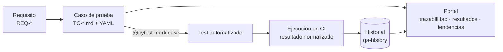

# Farmatodo QA Engineering & Quality Intelligence Platform

> **Prueba técnica para el puesto de Ingeniero de Calidad QA en Farmatodo**  
> Autor: **Ing. Yoel Maximiliano Almirón** · [GitHub @yoelalmiron1997](https://github.com/yoelalmiron1997) · octubre de 2026

Resuelta con **Specification-Driven Development**: cada requisito y cada caso de prueba se especifican primero, en archivos versionados. Los tests se vinculan a esa especificación, GitHub Actions los ejecuta y un portal publica la trazabilidad, los resultados, los flaky tests y la performance de cada corrida.

[](https://github.com/yoelalmiron1997/farmatodo-qa-test-engineering/actions/workflows/pr-checks.yml)
[](https://github.com/yoelalmiron1997/farmatodo-qa-test-engineering/actions/workflows/functional-tests.yml)
[](https://github.com/yoelalmiron1997/farmatodo-qa-test-engineering/actions/workflows/deploy-pages.yml)
[](LICENSE)

| | |
|---|---|
| 📊 **Portal de calidad** | https://yoelalmiron1997.github.io/farmatodo-qa-test-engineering/ |
| 📄 **Respuesta completa en PDF** | [`entrega/Respuesta-Prueba-Tecnica-QA-Farmatodo-Yoel-Almiron.pdf`](entrega/Respuesta-Prueba-Tecnica-QA-Farmatodo-Yoel-Almiron.pdf): los 4 ejercicios, punto por punto |
| ▶️ **Ejecuciones** | [GitHub Actions → functional-tests](https://github.com/yoelalmiron1997/farmatodo-qa-test-engineering/actions/workflows/functional-tests.yml) |
| 🏷️ **Versión entregada** | [Release v1.0.0](https://github.com/yoelalmiron1997/farmatodo-qa-test-engineering/releases/tag/v1.0.0): código, PDF, reportes y ambiente congelado · [CHANGELOG](CHANGELOG.md) |
| 📐 **Especificación (SDD)** | [`specs/SDD.md`](specs/SDD.md) · [requisitos](specs/requirements/requirements.yaml) · [casos](specs/cases/) · [decisiones (ADR)](specs/decisions/) |

## Los cuatro ejercicios

| # | Ejercicio | Resultado | Ver en el portal |
|---|---|---|---|
| 1 | Suite automatizada de wordcounter.net: palabras, caracteres y top 3 de Keyword Density, con reporte resumen | Selenium + Pytest + Page Object Model. 20 casos E2E contra un oráculo independiente. Reporte resumen por corrida en PDF, HTML y Markdown | [Casos](https://yoelalmiron1997.github.io/farmatodo-qa-test-engineering/generated/test-cases.html) · [Ejecución](https://yoelalmiron1997.github.io/farmatodo-qa-test-engineering/generated/execution.html) |
| 2 | Reporte de fallas de wordcounter.net | 4 defectos confirmados (1 mayor, 3 menores) y 2 mejoras, con pasos, evidencia y un test que reproduce cada defecto | [Bugs](https://yoelalmiron1997.github.io/farmatodo-qa-test-engineering/bugs/index.html) |
| 3 | 3 problemas de UX en farmatodo.com | Vista, pasos para replicar, evidencia, verificación en el DOM y propuesta | [UX](https://yoelalmiron1997.github.io/farmatodo-qa-test-engineering/ux/index.html) |
| 4 | Contador de frecuencia de palabras | Algoritmo propio con la salida exacta del enunciado y análisis de complejidad | [Algoritmo](https://yoelalmiron1997.github.io/farmatodo-qa-test-engineering/algorithm.html) |

## Specification-Driven Development

La especificación es la fuente única de verdad: el catálogo de casos, la matriz de trazabilidad y las páginas del portal se generan desde `specs/`, y CI rechaza cualquier cambio que las deje inconsistentes.



| Artefacto | Contenido | Volumen |
|---|---|---|
| [`specs/SDD.md`](specs/SDD.md) | Alcance, supuestos, estrategia, matriz de riesgo, criterios de entrada y salida, catálogo e inventario generados | v1.0.1 |
| [`requirements.yaml`](specs/requirements/requirements.yaml) | Requisitos con origen en el enunciado, criterios de aceptación y forma de verificación | 21 (16 del enunciado + 5 derivados) |
| [`cases/TC-*.md`](specs/cases/) | Un archivo por caso: front matter YAML (requisitos, riesgo, prioridad, nivel, técnicas) y cuerpo con objetivo, precondiciones, datos, pasos, resultado esperado y criterio de aceptación | 51 casos · P0: 9 · P1: 28 · P2: 14 |
| [`decisions/ADR-*.md`](specs/decisions/) | Decisiones de arquitectura y de prueba, con contexto y alternativas | 12 ADR |

**Ejemplo de caso** ([`TC-WC-003.md`](specs/cases/TC-WC-003.md)) y su test, vinculados por el marker:

```yaml
id: TC-WC-003
title: Top 3 de Keyword Density sin empates
requirement_ids: [REQ-WC-003]
priority: P0
level: e2e
risk_assessment: { impact: 5, likelihood: 4, score: 20, computed_priority: P0 }
techniques: [Partición de equivalencia, Diseño de datos para orden inequívoco]
```

```python
@pytest.mark.case("TC-WC-003")
def test_top_three_keywords(wordcounter, oracle, qa_settings, text): ...
```

**Prioridad por riesgo.** Puntaje = impacto × probabilidad: **P0** si es ≥ 15, **P1** entre 8 y 14, **P2** si es ≤ 7. El validador recalcula la prioridad y solo acepta una distinta con un motivo explícito (`priority_override_reason`).

**Validación automática** (`uv run qa specs validate`, en cada PR):

| Regla | Qué rechaza |
|---|---|
| SPEC001 · SPEC002 | Secciones obligatorias faltantes o archivo con nombre distinto del ID |
| PRI002 · PRI003 | Puntaje o prioridad que no coinciden con la matriz de riesgo |
| TRC001 · TRC002 | Casos que apuntan a requisitos inexistentes, o requisitos sin casos |
| IMP001 · IMP002 · IMP003 · IMP004 | Casos automatizables sin test, tests sin caso, markers a casos inexistentes o casos manuales con automatización |

**Cobertura de la especificación** (en vivo en el [dashboard](https://yoelalmiron1997.github.io/farmatodo-qa-test-engineering/#cobertura)): 100 % de los requisitos especificados y 100 % de los casos automatizables con su test, en P0, P1 y P2. El detalle está en la [matriz de trazabilidad](https://yoelalmiron1997.github.io/farmatodo-qa-test-engineering/generated/traceability.html).

## Estrategia de ejecución

| Práctica | Cómo se aplica |
|---|---|
| **Niveles** | 21 casos unitarios (algoritmo, oráculo, métricas, gate), 2 de integración (plugin de pytest y README reproducible), 23 E2E con Selenium (20 funcionales y 3 de performance) y 5 exploratorios con charter (Ejercicios 2 y 3) |
| **Oráculo independiente** | El resultado esperado se calcula desde el texto de entrada con las reglas del sitio, relevadas en un [spike de 42 observaciones](https://yoelalmiron1997.github.io/farmatodo-qa-test-engineering/exploration/wordcounter-spike.html). Los datos P0 están diseñados para que cualquier regla razonable dé el mismo resultado |
| **Aislamiento** | Navegador y perfil nuevos por test, orden aleatorio, esperas explícitas. La suite unitaria corre sin red ni navegador |
| **Flaky tests** | Cada intento se registra. Un test que falla y luego pasa es **FLAKY**, nunca PASS. El historial detecta inestabilidad entre corridas |
| **Disponibilidad del sitio** | Si wordcounter.net no responde antes del test, el caso queda **BLOCKED**: no se confunde con un defecto |
| **Quality gate** | Política declarativa en [`config/quality-gate.yaml`](config/quality-gate.yaml): un P0 que falla o es flaky bloquea; un defecto conocido documentado advierte. El gate define el estado del job |
| **Arquitectura** | Núcleo puro (oráculo, algoritmo, métricas, gate) separado de los adaptadores (Selenium, pytest, disco). Tres contratos de `import-linter` lo verifican en CI. Detalle en [Arquitectura](https://yoelalmiron1997.github.io/farmatodo-qa-test-engineering/architecture/index.html) |

## Tecnologías

Las versiones son las del lockfile (`uv.lock`): local y CI usan exactamente las mismas.

| Área | Tecnología | Versión | Para qué se usa |
|---|---|---|---|
| Lenguaje y entorno | [Python](https://www.python.org/) | 3.12.3 | Todo el framework y el algoritmo del ejercicio 4 |
| | [uv](https://docs.astral.sh/uv/) | — | Instala Python y dependencias desde el lockfile: un solo comando, el mismo resultado en cualquier máquina |
| Automatización UI | [Selenium WebDriver](https://www.selenium.dev/) | 4.51 | Pruebas E2E sobre wordcounter.net con Page Object Model. Selenium Manager descarga el driver compatible con el Chrome instalado |
| Ejecución de pruebas | [Pytest](https://docs.pytest.org/) | 9.1 | Runner de unit, integración, E2E y performance. Un plugin propio registra cada intento, los estados y las evidencias |
| | [pytest-rerunfailures](https://github.com/pytest-dev/pytest-rerunfailures) | 16.7 | Reintentos en E2E. Un test que pasa al reintentar se marca FLAKY, no PASS |
| | [pytest-randomly](https://github.com/pytest-dev/pytest-randomly) | 5.0 | Orden aleatorio de los tests: detecta dependencias ocultas entre ellos |
| | [pytest-socket](https://github.com/miketheman/pytest-socket) | 0.8 | Bloquea la red en los tests unitarios: garantiza que no dependen de sitios externos |
| | [coverage.py](https://coverage.readthedocs.io/) | 7.17 | Cobertura de código del framework (90 %) |
| Modelos y datos | [Pydantic](https://docs.pydantic.dev/) | 2.14 | Valida los casos de prueba (YAML), los resultados de cada corrida (schema v1) y la política del quality gate |
| | [PyYAML](https://pyyaml.org/) | 6.0 | Lee el front matter de los casos `TC-*.md` y la configuración |
| Calidad de código | [Ruff](https://docs.astral.sh/ruff/) | 0.17 | Lint y formato |
| | [mypy](https://mypy-lang.org/) | 2.4 | Tipado estático en modo `--strict` |
| | [import-linter](https://import-linter.readthedocs.io/) | 2.15 | Tres contratos de arquitectura: el núcleo no puede importar Selenium, pytest ni infraestructura |
| Portal y reportes | [MkDocs Material](https://squidfunk.github.io/mkdocs-material/) | 9.7 | Portal de calidad generado desde las specs y el historial |
| | [Mermaid](https://mermaid.js.org/) · [Chart.js](https://www.chartjs.org/) | — · 4.4 | Diagramas de arquitectura y gráficos de tendencia en el portal |
| | Chrome headless | — | Imprime el reporte resumen a PDF en CI |
| CI/CD | [GitHub Actions](https://docs.github.com/actions) | — | Ocho workflows con acciones fijadas por SHA y permisos mínimos |
| | [GitHub Pages](https://pages.github.com/) | — | Publica el portal |
| | [Docker](https://www.docker.com/) · [GitHub Packages](https://docs.github.com/packages) | — | Imagen del ambiente congelado (`ghcr.io`) para reproducir cualquier versión |
| [Dependabot](https://docs.github.com/code-security/dependabot) | — | Propone actualizaciones de dependencias y acciones |

## Instalación

Requisitos: [uv](https://docs.astral.sh/uv/getting-started/installation/) y, para las pruebas de UI, Google Chrome (Selenium Manager descarga el driver compatible).

```bash
git clone https://github.com/yoelalmiron1997/farmatodo-qa-test-engineering.git
cd farmatodo-qa-test-engineering
uv sync --group dev            # crea .venv con Python 3.12.3 y las versiones exactas del lockfile
```

## Ejecutar

| Qué | Comando |
|---|---|
| Ejercicio 4 con el ejemplo del enunciado | `uv run word-frequency data/samples/farmatodo_example.txt` |
| … con histograma de barras | `uv run word-frequency data/samples/farmatodo_example.txt --histogram` |
| Tests unitarios (sin red ni navegador) | `uv run pytest tests/unit` |
| Unit + integración (lo que corre `pytest` a secas) | `uv run pytest` |
| E2E contra wordcounter.net (Selenium) | `uv run pytest tests/e2e` |
| E2E con reintentos y recolección de resultados | `uv run pytest tests/e2e --reruns 2 --qa-results-dir reports` |
| Performance (P2, secuencial, ligera) | `uv run pytest tests/performance -p no:randomly --qa-results-dir reports` |
| Validar especificaciones y trazabilidad | `uv run qa specs validate` |
| Regenerar los bloques generados del SDD | `uv run qa specs generate` |
| Portal en local | `uv sync --group dev --group docs && uv run qa portal build && uv run mkdocs serve` |

Variables útiles: `QA_HEADLESS=false` (ver el navegador), `QA_TIMEOUT=15`, `QA_PERF_SAMPLES=5` (máximo 10), `QA_BASE_URL`, `QA_BROWSER` (`chrome` o `firefox`), `QA_BROWSER_VERSION` (versión exacta del navegador; vacío = el instalado).

## Ejecuciones y reportes: dónde verlos

Cada push a `master`, la corrida diaria y la ejecución manual de `functional-tests` dejan sus resultados en cuatro lugares:

| Dónde | Qué hay | Cuánto dura |
|---|---|---|
| [**Portal → Quality Dashboard**](https://yoelalmiron1997.github.io/farmatodo-qa-test-engineering/) | Estado de la última corrida, quality gate, cobertura y tendencia. Detalle en [Test Execution](https://yoelalmiron1997.github.io/farmatodo-qa-test-engineering/generated/execution.html), [Flaky Tests](https://yoelalmiron1997.github.io/farmatodo-qa-test-engineering/generated/flaky.html) y [Performance](https://yoelalmiron1997.github.io/farmatodo-qa-test-engineering/generated/performance.html) | Siempre (se regenera tras cada corrida) |
| [**Actions → functional-tests**](https://github.com/yoelalmiron1997/farmatodo-qa-test-engineering/actions/workflows/functional-tests.yml) → abrir una corrida | El **reporte resumen** en la propia página de la corrida (*Summary*) | 90 días (logs de GitHub) |
| Misma corrida → sección *Artifacts* → **`functional-reports`** (zip) | Reporte resumen en **PDF**, HTML y Markdown, evidencias de cada fallo y datos crudos (ver tabla siguiente) | 30 días |
| Rama [**`qa-history`**](https://github.com/yoelalmiron1997/farmatodo-qa-test-engineering/tree/qa-history/runs) | Un JSON por corrida: `runs/<workflow>/<AAAA>/<MM>/<run_id>-<intento>.json`. Es la fuente de las tendencias del portal | Permanente |

`performance` funciona igual: [su workflow](https://github.com/yoelalmiron1997/farmatodo-qa-test-engineering/actions/workflows/performance.yml) y el artifact **`performance-reports`**.

Contenido del artifact (igual a la carpeta `reports/` cuando se corre en local):

| Archivo | Para qué |
|---|---|
| `summary.pdf` | Reporte resumen listo para compartir o imprimir |
| `summary.html` · `summary.md` | El mismo reporte en HTML y Markdown |
| `evidence/*.png` · `evidence/*.html` | Captura de pantalla y DOM de cada intento fallido |
| `run-result.json` | Resultado normalizado (schema v1) con estados, intentos, entorno y decisión del gate |
| `junit-unit.xml` · `junit-e2e.xml` | JUnit para cualquier herramienta de CI |
| `attempts.jsonl` · `session-*.json` | Registro crudo de cada intento, tal como lo recolectó el plugin |

En local, después de correr los tests con `--qa-results-dir reports`:

```bash
uv run qa results build --results-dir reports --out reports/run-result.json   # normaliza + evalúa el gate
uv run qa report summary --run reports/run-result.json --out-dir reports      # reports/summary.md y summary.html
uv run qa gate --run reports/run-result.json                                  # código de salida = decisión del gate
```

El **reporte resumen** muestra escenarios ejecutados, aprobados, flaky, fallidos, omitidos y bloqueados, y para cada fallo el caso, la categoría, la descripción del error y la evidencia.

Cómo leer los estados:

- **PASS**: aprobado en el primer intento.
- **FLAKY**: falló y luego pasó en la misma corrida. Requiere atención y bloquea si es P0.
- **BLOCKED**: el sitio no estaba disponible antes del test. No es un fallo del producto, pero un P0 bloqueado deja el gate inconclusivo.
- **FAIL conocido**: TC-WC-017…020 describen el comportamiento correcto ante los defectos del Ejercicio 2 y fallan mientras el defecto exista. Cuando el sitio lo corrija, pasarán solos.

## Versiones y reproducibilidad

Cada versión entregada se congela como un [release de GitHub](https://github.com/yoelalmiron1997/farmatodo-qa-test-engineering/releases) para poder reproducirla exactamente en otro momento:

| Qué se congela | Cómo |
|---|---|
| Código, especificaciones y documentación | Tag `vX.Y.Z` (la versión de `pyproject.toml` debe coincidir) |
| Python | Versión exacta en `.python-version` (3.12.3) |
| Dependencias | `uv.lock` con hashes; en el release también como `requirements.lock.txt` |
| Navegador y driver | Versión registrada en cada resultado; se reproduce con `QA_BROWSER_VERSION=<versión>`, que hace que Selenium Manager descargue esa versión exacta de Chrome for Testing |
| Ambiente completo | Imagen Docker en [GitHub Packages](https://github.com/yoelalmiron1997/farmatodo-qa-test-engineering/pkgs/container/farmatodo-qa-test-engineering) con Python, dependencias, Chrome y chromedriver exactos |
| Runner y herramientas | Imagen fija (`ubuntu-24.04`), uv fijado y acciones fijadas por SHA, todo registrado en `environment.json` |
| Evidencia | PDF de la respuesta, reporte de la corrida de validación y reportes completos adjuntos al release |

Ejecutar la versión entregada sin instalar nada más que Docker:

```bash
docker run --rm ghcr.io/yoelalmiron1997/farmatodo-qa-test-engineering:1.0.0                  # E2E + reporte resumen
docker run --rm ghcr.io/yoelalmiron1997/farmatodo-qa-test-engineering:1.0.0 pytest           # unit + integración
docker run --rm -v "$PWD/reports:/app/reports" ghcr.io/yoelalmiron1997/farmatodo-qa-test-engineering:1.0.0   # reportes en tu carpeta
```

Cada release incluye en sus notas los comandos exactos para reproducirlo. Para publicar una versión nueva: actualizar `version` en `pyproject.toml`, agregar `release-notes/vX.Y.Z.md` y la entrada en [`CHANGELOG.md`](CHANGELOG.md), y subir el tag.

## CI/CD

| Workflow | Cuándo | Qué hace |
|---|---|---|
| `pr-checks` | PR y push a `master` y `develop` | ruff, formato, mypy, import-linter, `qa specs validate`, unit + integración con cobertura, `mkdocs build --strict`. El job `readme-smoke` corre los comandos de este README en un runner limpio |
| `functional-tests` | push a `master`, diario y manual | Unit + integración sin reintentos, E2E headless con reintentos, resultado normalizado, reporte resumen (PDF, HTML, Markdown), artifacts y quality gate. Persiste el historial |
| `performance` | semanal y manual | Mediciones P2 secuenciales. Persiste el historial |
| `deploy-pages` | cambios en docs o specs, fin de las corridas anteriores, manual | Genera el portal desde specs + `qa-history` y lo publica en GitHub Pages |
| `release` | tag `vX.Y.Z` | Valida todo (estático, unit, integración, E2E) y, si el gate no bloquea, publica el release con los PDF, el paquete, las dependencias exactas, los reportes y `environment.json` |
| `container` | push a `master`, PR que tocan el ambiente y tags | Construye la imagen Docker y la prueba (algoritmo, unit + integración y E2E dentro del contenedor). Con un tag la publica en GitHub Packages |
| `sync-develop` | push a `master` | Avanza `develop` hasta `master` (o hace merge si divergió; nunca fuerza) |
| `persist-history` | reutilizable | Agrega `runs/<workflow>/<AAAA>/<MM>/<run_id>-<intento>.json` a la rama `qa-history` sin sobrescribir |

**Ramas:** `master` es la rama principal y está protegida: solo acepta cambios por pull request con `pr-checks` en verde, sin force-push ni borrado. `develop` se sincroniza con `master` automáticamente y `qa-history` solo la escribe CI.

Las acciones están fijadas por SHA de commit, con permisos mínimos por job y concurrencia controlada. Los PR nunca publican ni escriben historial.

## Estructura

```text
specs/        SDD, requisitos, casos TC-*.md y decisiones (ADR): la fuente de verdad
config/       política del quality gate
src/          farmatodo_qa: algoritmo, oráculo, Page Objects, plugin de pytest, métricas, gate, historial, portal
tests/        unit/{product,framework} · integration · e2e · performance · support
data/         ejemplo del enunciado, salida esperada y observaciones del spike
docs/         portal (bugs, ux, estrategia, arquitectura, algoritmo, conclusiones)
entrega/      respuesta completa en PDF y su fuente HTML
release-notes/ notas de cada versión publicada
scripts/      congelamiento del ambiente para los releases
.github/      workflows y Dependabot
```

Licencia: MIT.
