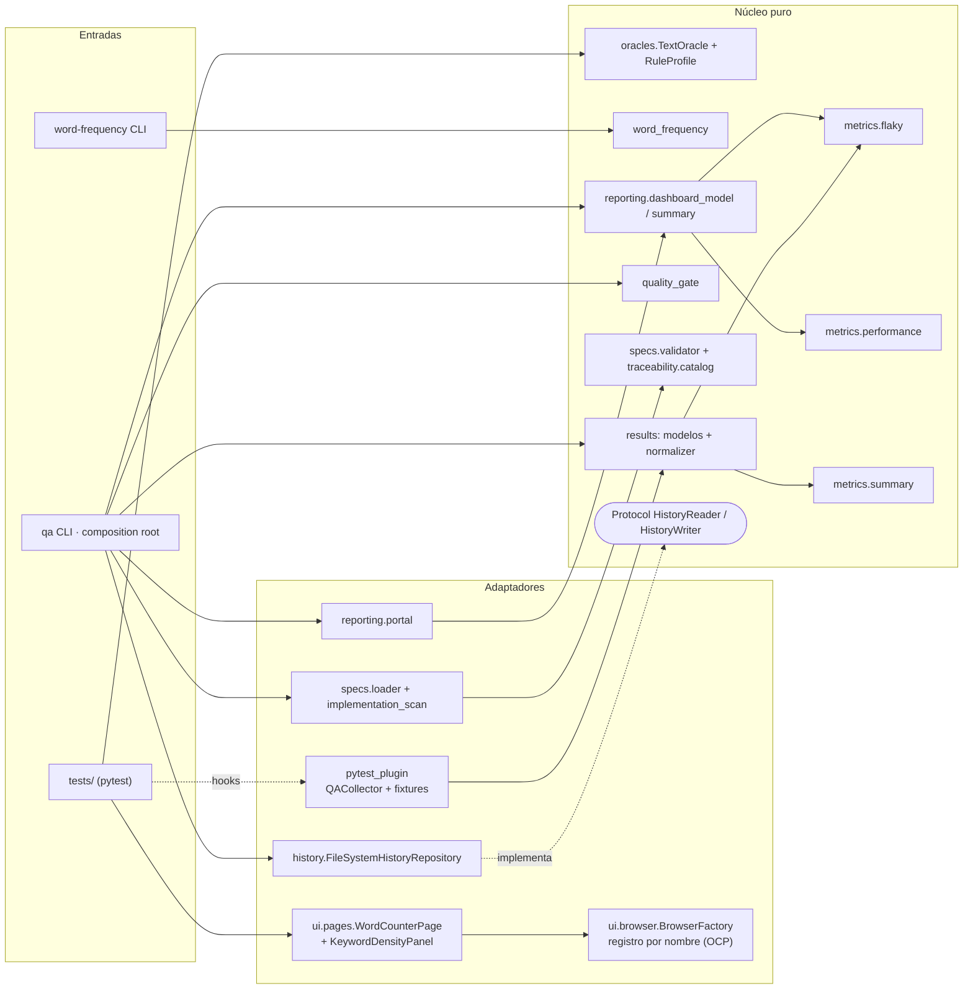
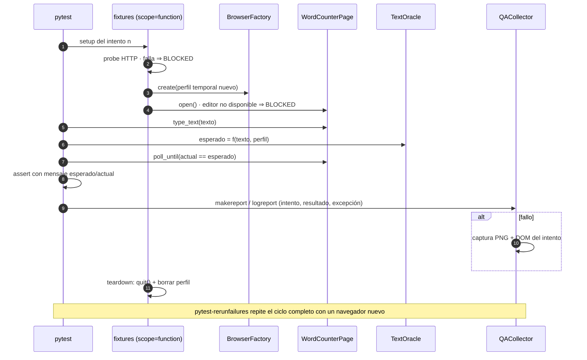
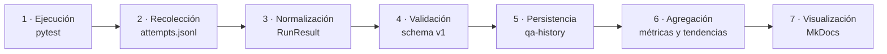
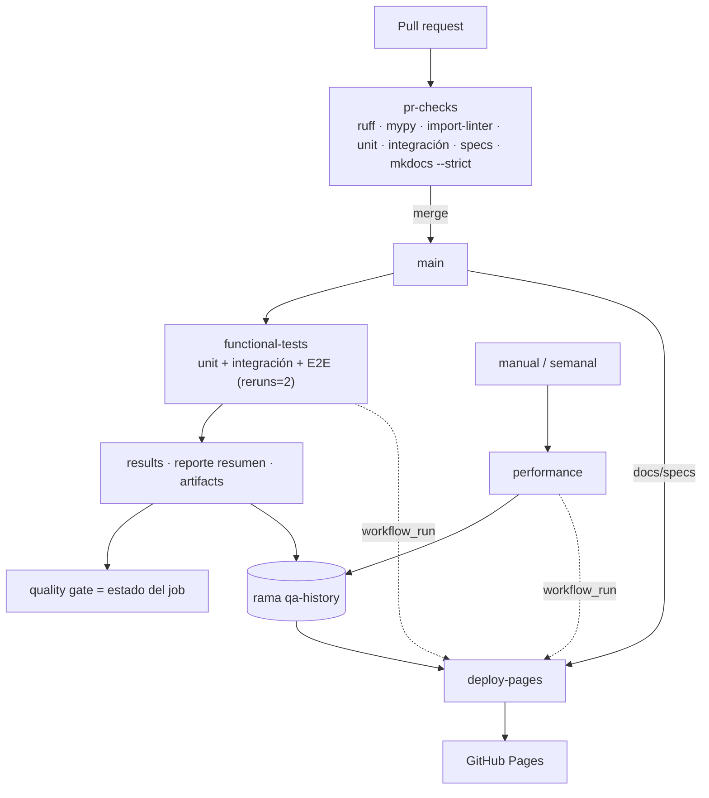
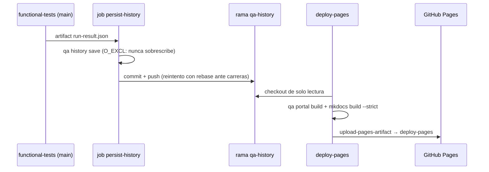

# Arquitectura

**Núcleo puro + adaptadores delgados.** Todo lo que decide (oráculo, algoritmo, clasificación, métricas, gate, trazabilidad, modelo del dashboard) es Python puro, sin Selenium, pytest, red ni disco. La infraestructura traduce desde y hacia ese núcleo. La regla de dependencias se **verifica** en CI con `import-linter` (`uv run lint-imports`).

## Componentes y dependencias (SOLID)



| Principio | Dónde se aplica | Cómo se verifica |
|---|---|---|
| **S** | Page Objects sin aserciones; oráculo sin Selenium; clasificador sin I/O; renderers sin cálculo; el plugin solo recolecta | Revisión de código + contratos de imports |
| **O** | Navegadores por registro (`BrowserFactory.register`); categorías de fallo y política del gate como datos; nuevos casos sin tocar el reporting | `test_categories_are_extensible_without_code_changes`, política alternativa en `test_quality_gate` |
| **L** | Repositorio de historial en disco y en memoria con la misma suite de contrato | `test_history_repository.py` parametrizado por implementación |
| **I** | `HistoryReader` y `HistoryWriter` separados; el renderer no conoce navegadores; el oráculo no conoce pytest | mypy `--strict` |
| **D** | El CLI (composition root) inyecta implementaciones; el núcleo no importa infraestructura | `import-linter`: 3 contratos |

**Sin sobreingeniería:** no hay interfaz para Page Objects (un solo sitio), ni *services* o *managers* genéricos, ni jerarquías de tests. Los `Protocol` existen solo donde hay sustitución real (persistencia).

## Ciclo de vida de un test E2E



## Flujo de datos de observabilidad



## CI/CD



## Persistencia histórica y despliegue



## Estructura del repositorio

```text
specs/            fuente: SDD, requisitos, casos TC-*.md, ADRs
config/           política del quality gate
src/farmatodo_qa/ word_frequency · oracles · results · metrics · quality_gate · specs · traceability
                  history · reporting · ui (Selenium) · pytest_plugin · config · cli
tests/            unit/{product,framework} · integration · e2e · performance · support
data/             ejemplo del PDF y observaciones del spike
docs/             portal editable (bugs, ux, estrategia, arquitectura…) + generated/ (no versionado)
.github/          workflows y Dependabot
```
