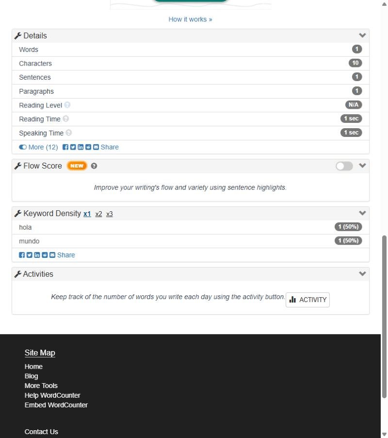

# BUG-WC-001 — Contador y Keyword Density no coinciden ante un punto sin espacio

**Severidad:** Menor · **Estado:** confirmado (reproducido con tipeo real y por script) · **Caso:** [TC-WC-017](../generated/cases/TC-WC-017.md)

## Precondiciones
https://wordcounter.net/ con la configuración por defecto y el editor vacío.

## Pasos
1. Escribir en el editor: `hola.mundo` (sin espacio después del punto).
2. Observar el encabezado, el panel *Details* y *Keyword Density*.

## Resultado esperado
Ambas funciones aplican la misma regla de separación: si el texto tiene 1 palabra, Keyword Density muestra 1 entrada; si tiene 2, muestra 2.

## Resultado actual
El encabezado y *Details* indican **1 word**, pero *Keyword Density* lista **2** entradas: `hola` 1 (50 %) y `mundo` 1 (50 %).

Además, el contador trata distinto signos equivalentes: `hola,mundo` cuenta **2** palabras y `hola.mundo` cuenta **1**.

## Evidencia

## Impacto
La falta de espacio después de un punto es un error de tipeo frecuente ("fin.Inicio"). Los dos indicadores del mismo texto se contradicen y el usuario no sabe cuál es correcto.

## Sugerencia
Unificar la tokenización del contador y de Keyword Density en una sola función.
