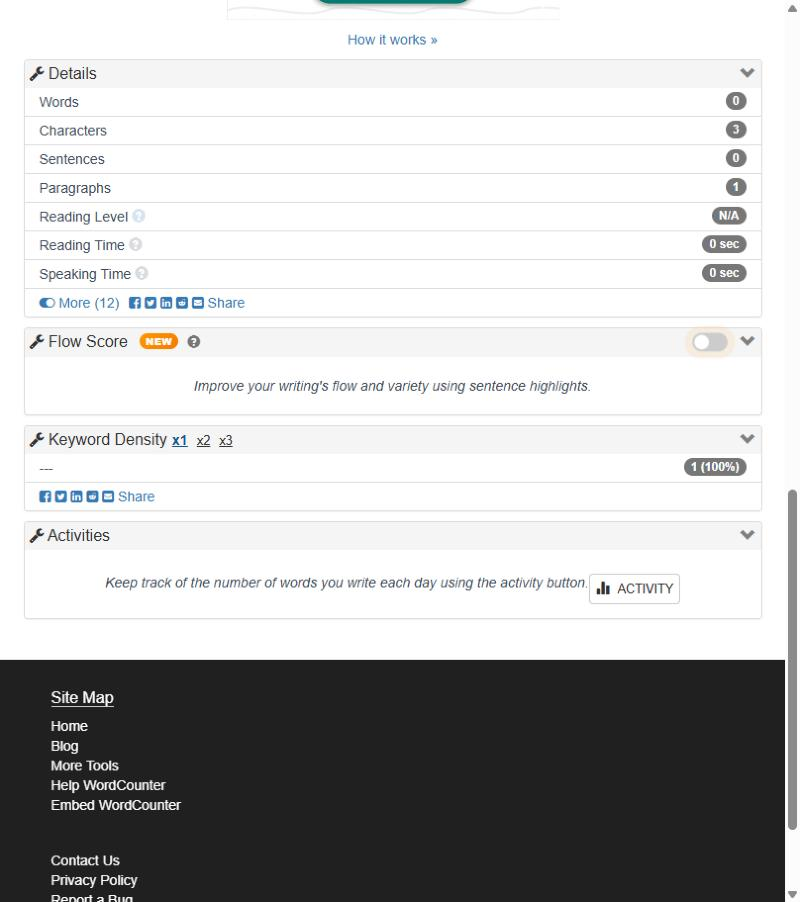

# BUG-WC-002 — Un token formado solo por guiones aparece como palabra clave con 0 palabras

**Severidad:** Menor · **Estado:** confirmado (tipeo real y script) · **Caso:** [TC-WC-018](../generated/cases/TC-WC-018.md)

## Precondiciones
https://wordcounter.net/ con la configuración por defecto y el editor vacío.

## Pasos
1. Escribir `---` en el editor.
2. Observar el encabezado y *Keyword Density*.

## Resultado esperado
Si el contador indica 0 palabras, Keyword Density no muestra entradas (como ocurre con números o letras sueltas).

## Resultado actual
El encabezado muestra **0 words 3 characters**; *Keyword Density* lista `---` con **1 (100 %)**.

## Evidencia

## Impacto
Separadores de Markdown o texto plano (`---`, `***`) contaminan la densidad de palabras clave y pueden desplazar palabras reales del top.

## Sugerencia
Excluir de Keyword Density los tokens sin letras ni dígitos, con la misma regla que ya usa el contador.
