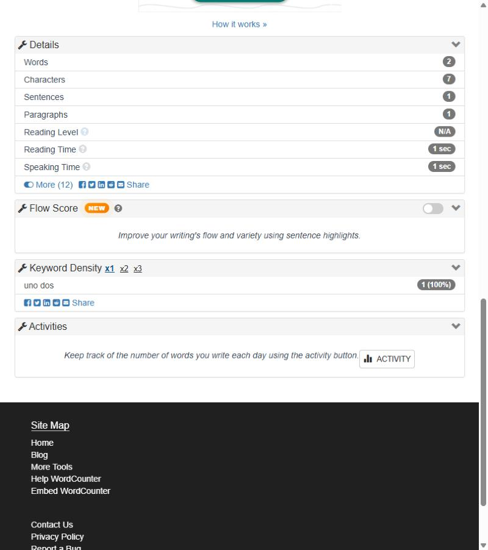

# BUG-WC-003 — Keyword Density no separa palabras unidas por espacio no separable (NBSP)

**Severidad:** Mayor · **Estado:** confirmado (dos veces, por script) · **Caso:** [TC-WC-019](../generated/cases/TC-WC-019.md)

## Precondiciones
https://wordcounter.net/ con la configuración por defecto. Un texto con el carácter U+00A0 (espacio no separable), habitual al copiar desde procesadores de texto o páginas web.

## Pasos
1. Pegar en el editor `uno dos`, donde el espacio es U+00A0 (en la prueba se cargó con `value` + evento `keyup`, porque el teclado no produce NBSP de forma directa).
2. Observar *Details* y *Keyword Density*.

## Resultado esperado
Keyword Density muestra `uno` 1 y `dos` 1, coherente con el contador.

## Resultado actual
El contador indica **2 words**, pero *Keyword Density* muestra una única entrada **`uno dos` 1 (100 %)**.

## Evidencia

## Impacto
Severidad mayor porque altera el resultado principal de Keyword Density en un uso frecuente (pegar texto): en un documento con muchos NBSP, el top-3 puede mostrar pares de palabras inexistentes y ocultar las verdaderas más frecuentes.

## Sugerencia
Usar la clase Unicode de espacios (como el contador) al tokenizar Keyword Density, o normalizar U+00A0 a espacio antes de contar.
