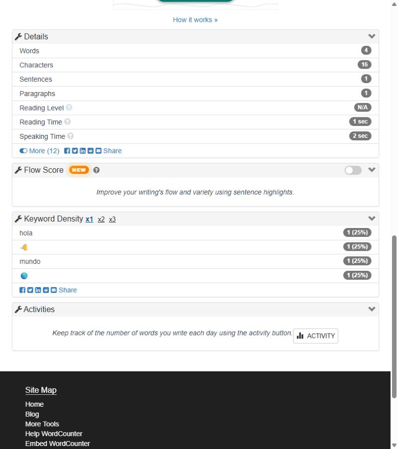

# BUG-WC-004 — Cada emoji cuenta como 2 caracteres

**Severidad:** Menor · **Estado:** confirmado (dos veces, por script) · **Casos:** [TC-WC-020](../generated/cases/TC-WC-020.md) (comportamiento correcto) y [TC-WC-016](../generated/cases/TC-WC-016.md) (caracterización del actual)

## Precondiciones
https://wordcounter.net/ con la configuración por defecto.

## Pasos
1. Pegar `hola 👋 mundo 🌎` (cargado por script, porque ChromeDriver no tipea caracteres fuera del plano multilingüe básico).
2. Observar el contador de caracteres.

## Resultado esperado
**14** caracteres: 9 letras, 3 espacios y 2 emojis, cada uno percibido como un carácter.

## Resultado actual
**16** caracteres: cada emoji suma 2, porque el sitio cuenta unidades de código UTF-16 (`String.length`). Además, los emojis aparecen como palabras clave en Keyword Density.

## Evidencia

## Impacto
Quien escribe para un límite de caracteres (redes sociales, SMS, metadatos SEO) ve un total mayor que el real y puede recortar texto sin necesidad.

## Sugerencia
Contar caracteres percibidos (`Intl.Segmenter` con granularidad `grapheme`, o al menos `[...text].length`) y excluir emojis de Keyword Density.
