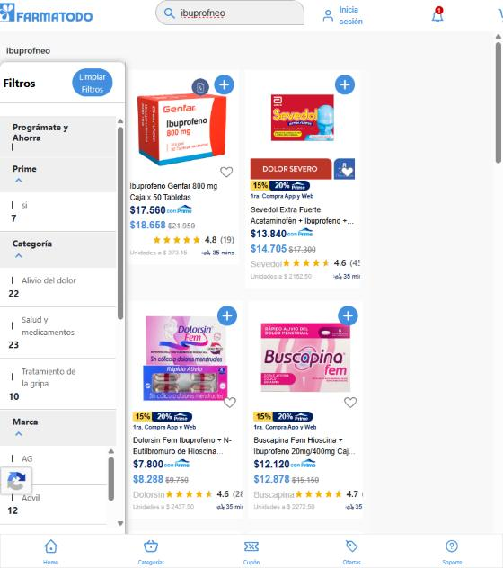
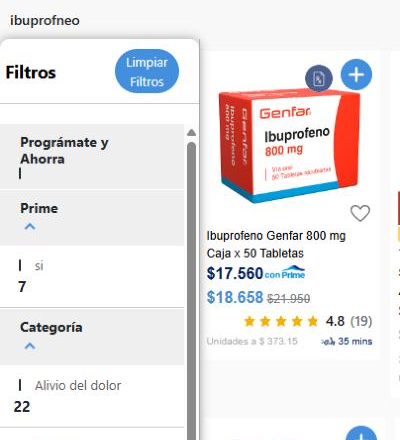

# UX-FT-002 — Los filtros de búsqueda no se reconocen como seleccionables y no son accesibles

**Vista:** web desktop (~800 px de ancho) · **Flujo:** búsqueda de productos · **Severidad:** 3 — mayor · **Caso:** TC-UX-001

## Qué está mal
En los resultados de búsqueda, cada opción de filtro (Categoría, Marca, Subcategoría, Prime) tiene un indicador de selección que, a este ancho, se dibuja como una **raya vertical de 2 × 12 px** en lugar de un círculo o casilla. No se percibe como un control. Además, las opciones son `div` genéricos: no tienen rol (`checkbox`/`radio`), ni `tabindex`, ni estado `aria-checked`. Por eso no entran en el orden de tabulación y un lector de pantalla no las anuncia como controles (conclusión a partir del DOM; no se probó con un lector de pantalla).

## Cómo replicarlo
1. Abrir `https://www.farmatodo.com.co/` con la ventana del navegador a unos 800 px de ancho.
2. Buscar un término; la prueba se hizo con `ibuprofneo` (mal escrito a propósito), que devuelve resultados de ibuprofeno.
3. Observar el panel **Filtros**: junto a "Alivio del dolor", "Advil", "si" (Prime) se ve una raya fina, no una casilla.
4. Inspeccionar una opción (DevTools): es un `div` sin `tabindex` ni rol, por lo que no entra en el orden de tabulación.

## Evidencia
| Resultados a ~800 px | Detalle del panel de filtros |
|---|---|
|  |  |

**Verificación en el DOM:** cada opción es `div.row > div.cont-circle > div.circle` + `p.text-name-list`. El `div.circle` mide **2 × 12 px**, la página no tiene ningún `input[type=checkbox]`, y las opciones no tienen `role`, `tabindex` ni `aria-checked`.

## Impacto
- Usuarios en general: los filtros parecen texto informativo, no opciones, lo que aumenta el esfuerzo para acotar resultados (heurísticas *reconocimiento antes que recuerdo* y *consistencia y estándares*).
- Usuarios de teclado y lector de pantalla: no pueden filtrar. Incumple WCAG 2.2 §2.1.1 (Teclado) y §4.1.2 (Nombre, función, valor). El objetivo táctil tampoco alcanza el mínimo de §2.5.8 (24 × 24 px).

## Propuesta
Usar `input type="checkbox"` nativos con `<label>` asociado (o el patrón ARIA equivalente con `role="checkbox"`, `tabindex="0"` y `aria-checked`), un indicador de tamaño fijo (`min-width`/`flex-shrink: 0`) de al menos 24 × 24 px y estado seleccionado visible.
