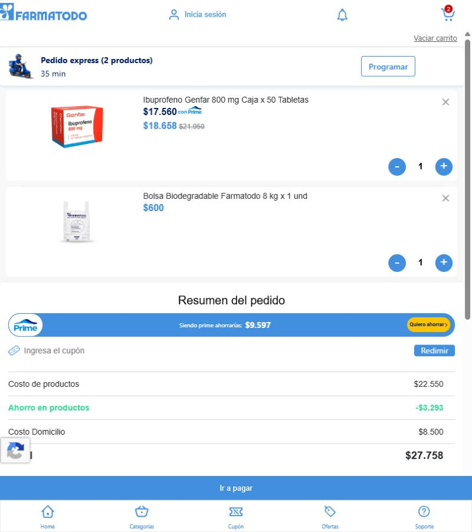
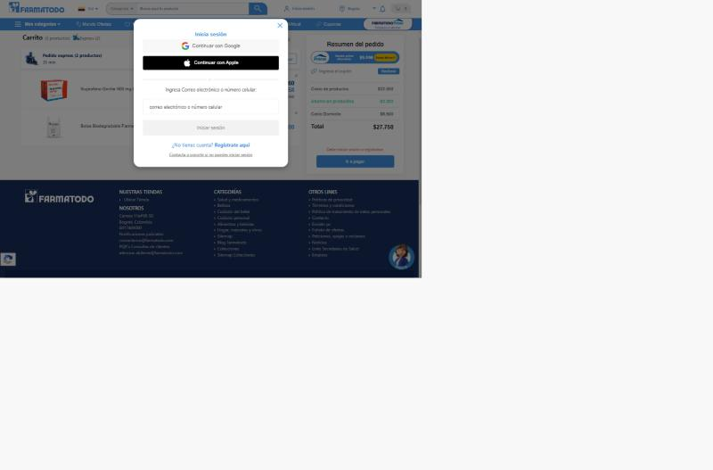

# UX-FT-003 — El carrito acepta un medicamento con fórmula sin avisar y agrega una bolsa que el usuario no pidió

**Vista:** web desktop (1366 px y ~800 px) · **Flujo:** detalle de producto → carrito → checkout · **Severidad:** 3 — mayor · **Caso:** TC-UX-003

## Qué está mal
1. **Requisito de fórmula médica invisible en el flujo de compra.** *Ibuprofeno Genfar 800 mg × 50* requiere fórmula médica. El aviso existe en la página de producto, pero lejos del botón de compra (debajo de la imagen o de la ficha técnica). Al presionar "Agregar producto" no aparece ningún mensaje: el botón solo se convierte en un selector de cantidad. En el carrito tampoco hay ninguna indicación, y "Ir a pagar" está disponible.
2. **Producto agregado sin acción del usuario.** Tras agregar solo el ibuprofeno, el carrito muestra **2 productos**: el segundo es "Bolsa Biodegradable Farmatodo 8 kg × 1 und" ($600), sin ninguna explicación. Al quitar el ibuprofeno, la bolsa desaparece sola, lo que confirma que se agrega automáticamente.

## Cómo replicarlo
1. Abrir `https://www.farmatodo.com.co/producto/1000591-ibuprofeno-genfar-800-mg-caja-x-50-tabletas` a 1366 px.
2. Presionar **Agregar producto**: no aparece ningún aviso sobre la fórmula.
3. Abrir el carrito (`/carrito`): figuran el ibuprofeno y la bolsa biodegradable ($600), sin mención de la fórmula ni de por qué está la bolsa.
4. Presionar **Ir a pagar**: se abre el modal de inicio de sesión. Este es el límite del análisis.

## Evidencia
| Tras "Agregar producto" (1366 px) | Carrito (1366 px) | Carrito (~800 px) | Checkout |
|---|---|---|---|
|  |  |  |  |

## Impacto
- El usuario descubre tarde (al pagar o al recibir) que necesita una fórmula: pedidos fallidos, frustración y contactos a soporte. Viola la *visibilidad del estado del sistema* y la *prevención de errores*.
- Un ítem cobrado que el usuario no agregó afecta la confianza y puede percibirse como un patrón engañoso (*sneak into basket*), aunque la bolsa responda a una política o norma.

## Propuesta
- Mostrar una etiqueta textual "Requiere fórmula médica" en la tarjeta de búsqueda, junto al botón de compra y en la línea del carrito, con el paso de carga de la fórmula explicado antes del pago.
- Si la bolsa es obligatoria, rotularla en el carrito con el motivo ("Bolsa requerida por normativa ambiental") e informar al agregar el primer producto. Si no lo es, permitir quitarla.
