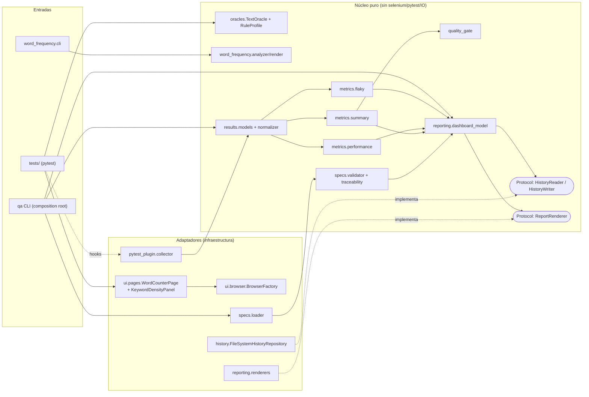
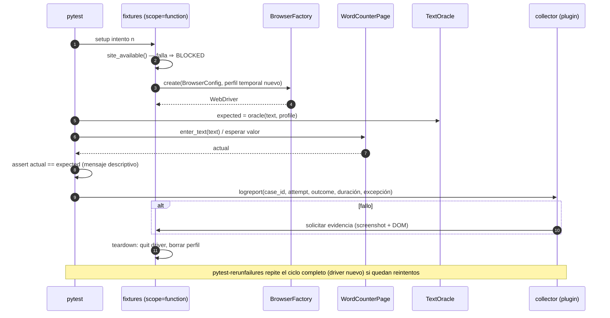
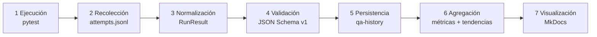
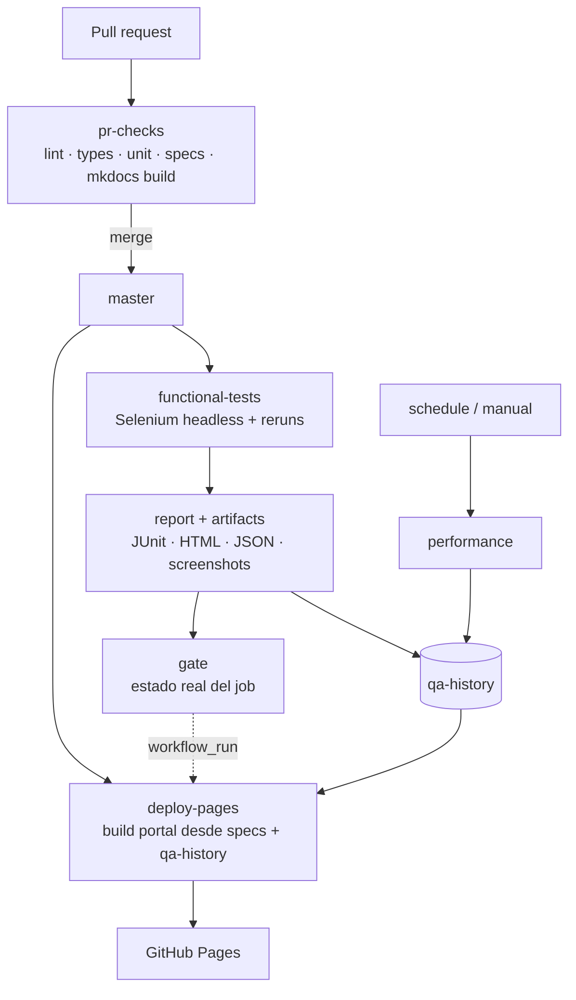
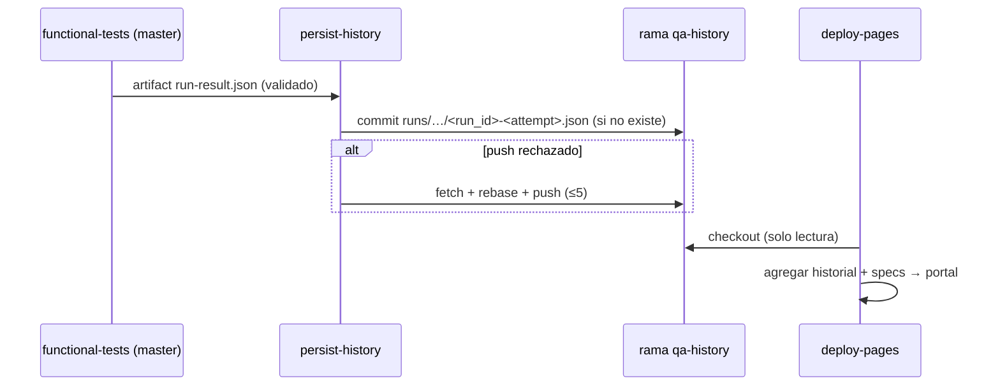

# SDD — Farmatodo QA Engineering & Quality Intelligence Platform

> **Estado: v1.0.0 — implementado.** La v0.1.0 (Fases 1 y 2) se aprobó para implementación el 2026-10-23. Las hipótesis sobre wordcounter.net y farmatodo.com se resolvieron en el spike de exploración (§2.5). Los resultados de ejecución **no** se escriben en este documento: los publica el portal desde el historial de GitHub Actions.

Resumen del catálogo:

<!-- BEGIN GENERATED: summary — no editar a mano -->
**51 casos** · P0: 9 · P1: 28 · P2: 14 · e2e: 23 · integration: 2 · manual: 5 · unit: 21 · requisitos: 21
<!-- END GENERATED: summary -->

**Índice**

1. Introducción · 2. Alcance · 3. Requerimientos · 4. Criterios de aceptación · 5. Estrategia de testing · 6. Análisis de riesgos · 7. Priorización · 8. Técnicas de diseño · 9. Especificación de escenarios · 10. Matriz de trazabilidad · 11. Criterios de entrada y salida · 12. Riesgos y limitaciones · 13. Historial de modificaciones
**Anexos:** A. Arquitectura SOLID · B. Aislamiento · C. Flaky tests · D. Performance · E. Observabilidad y esquema de datos · F. CI/CD · G. Historial persistente · H. Portal GitHub Pages · I. ADRs propuestos · J. Correo de preguntas · K. Estructura del repositorio · L. Versiones y reproducibilidad

---

## 1. Introducción

### 1.1 Propósito
Este documento es la especificación fuente del proyecto. Define **qué** se valida, **por qué**, **con qué prioridad** y **cómo se demuestra**, antes de escribir código. Cada caso de prueba vive en `specs/cases/TC-*.md` (YAML Front Matter + Markdown) y cada requisito en `specs/requirements/requirements.yaml`. El SDD **referencia** esas fuentes; las tablas de inventario y trazabilidad de este documento son **bloques generados** y el CI falla si divergen (§10.3).

### 1.2 Contexto: análisis del PDF
La prueba técnica de Farmatodo contiene cuatro ejercicios:

| # | Ejercicio | Naturaleza | Entregable exigido por el PDF | Exigencias implícitas detectadas |
|---|---|---|---|---|
| 1 | Suite automatizada sobre wordcounter.net | Automatización E2E | Suite que valide palabras, caracteres y top-3 de Keyword Density; **reporte resumen** (ejecutados / aprobados / fallidos + descripción del error); repo en GitHub con instrucciones | Configuración por defecto obligatoria; libertad de escenarios; se valora documentar suposiciones; **una única ronda de preguntas por correo** |
| 2 | Reporte de fallas de wordcounter.net | Exploración manual + comunicación | Reporte breve de defectos **u oportunidades de mejora** | Claridad de comunicación; el PDF lo vincula a "probar bien manualmente antes de automatizar" |
| 3 | UX de farmatodo.com | Evaluación heurística | Reporte con **3 problemas** de UX, explicación, cómo replicarlo y **vista** (desktop, responsive o mobile) | Vistas sugeridas: búsqueda, detalle, carrito, checkout |
| 4 | Contador de frecuencia de palabras | Algoritmo propio + unit tests | Algoritmo que lea un archivo, cuente frecuencias, palabras y caracteres (con espacios, **sin saltos de línea**), histograma; **orden desc. con desempate alfabético**; **explicar complejidad**; repo + instrucciones | Salida del ejemplo: `14 words`, `99 characters`, `farmatodo: 6`, `cuida: 3`, `salud: 2`, `tu: 2`, `toda: 1` |

**Verificación del ejemplo del Ejercicio 4 (hecha a mano y con script durante el análisis):** línea 1 = 70 caracteres (62 letras + 8 espacios), línea 2 = 29 caracteres (25 + 4); total 99 sin el salto de línea; 9 + 5 = 14 palabras. Confirma que el salto de línea no se cuenta y que `salud` precede a `tu` por desempate alfabético.

### 1.3 Restricciones identificadas
- **R-01** Usar siempre la configuración por defecto de wordcounter.net (PDF §1).
- **R-02** Lenguaje/framework libre → Python 3.12 + Selenium + Pytest (ADR-001/002).
- **R-03** Una sola ronda de preguntas (Anexo J). Lo no respondido se resuelve con suposiciones documentadas.
- **R-04** Los sitios son de terceros: sin carga, sin concurrencia, sin evadir protecciones anti-bot ni CAPTCHAs.
- **R-05** No inventar localizadores, defectos ni hallazgos UX: todo sale de exploración con evidencia.
- **R-06** Sin compras reales ni datos personales en evidencias (Ejercicio 3).

### 1.4 Glosario
| Término | Definición |
|---|---|
| Oráculo | Implementación independiente que calcula el valor esperado **solo a partir del dato de entrada**, nunca leyendo la aplicación. |
| Perfil de reglas | Configuración declarativa del oráculo (separadores, case folding, stop words, conteo de saltos de línea) confirmada por exploración. |
| Intento | Una ejecución individual del cuerpo de un test (el primero o un reintento). |
| Caso ejecutado | Caso con al menos un intento cuyo resultado final es PASS, FLAKY o FAIL. |
| Corrida (run) | Una ejecución de workflow identificada por `run_id` + `run_attempt`. |
| Caracterización | Prueba que documenta y luego fija como regresión un comportamiento observado que la especificación no define. |

---

## 2. Alcance

### 2.1 Dentro del alcance
- Ejercicios 1–4 del PDF, completos.
- Framework de calidad propio: oráculos, recolección por intento, clasificación flaky, performance ligera, agregación, quality gate, trazabilidad, historial y portal.
- CI/CD con GitHub Actions y portal estático en GitHub Pages.

### 2.2 Fuera del alcance
- Pruebas de carga, estrés o concurrencia contra sitios de terceros.
- Opciones no predeterminadas de WordCounter en la suite automatizada (pueden explorarse manualmente, rotuladas como tales).
- Automatización de farmatodo.com (el Ejercicio 3 es evaluación UX manual; automatizarlo no aporta y aumenta el riesgo de bloqueo anti-bot).
- Compras reales, creación de cuentas automatizada, pagos.
- Navegadores distintos de Chrome en la primera versión (la fábrica queda abierta a extensión, ADR-004).

### 2.3 Origen de los requisitos
Se distinguen dos fuentes, y el portal las muestra por separado para no inflar la cobertura del PDF:
- **PDF** (`REQ-WC-*`, `REQ-RPT-*`, `REQ-DEL-*`, `REQ-BUG-*`, `REQ-UX-*`, `REQ-ALG-*`): obligatorios para la entrega.
- **Derivados de la consigna de ingeniería** (`REQ-QA-*`): calidad del propio framework.

### 2.4 Suposiciones
| ID | Suposición | Si resulta falsa |
|---|---|---|
| A-01 | "Top 3" = las tres primeras entradas de Keyword Density tal como el sitio las muestra con la configuración por defecto (incluidos sus filtros). | Ajustar el perfil del oráculo, no la regla del caso. |
| A-02 | El porcentaje de Keyword Density no es objeto de validación (el PDF pide "número de repeticiones"). Se registra como dato informativo. | Agregar caso P1 de porcentaje. |
| A-03 | Ejercicio 4: palabra = secuencia máxima de letras/dígitos Unicode, con apóstrofo o guion **internos**; frecuencias insensibles a mayúsculas (`casefold`) y en forma NFC (D-ALG-1). | Cambiar el tokenizador (un solo módulo) y los golden files. |
| A-04 | Ejercicio 4: `\r` y `\n` son saltos de línea; BOM UTF-8 no es contenido; la tabulación sí es carácter. | Ajustar TC-ALG-003/006. |
| A-05 | Ejercicio 4: desempate alfabético por orden de punto de código de la forma normalizada (determinista, independiente del locale) (D-ALG-2). | Usar collation (`locale`/PyICU) y documentar dependencia. |
| A-06 | Ejercicio 4: la salida por defecto replica exactamente el ejemplo; el histograma gráfico se agrega con `--histogram` (D-ALG-3). | Imprimir barras por defecto debajo de la lista. |
| A-07 | Ejercicio 3: emulación de dispositivo en DevTools es aceptable como "responsive"; "mobile" se reporta solo si se usa un dispositivo real. | Repetir hallazgos en dispositivo real. |

### 2.5 Hipótesis y resultado del spike (2026-10-23)
La exploración se hizo antes de codificar el oráculo. El detalle está en `docs/exploration/wordcounter-spike.md` y los datos crudos (42 observaciones) en `data/observations/wordcounter-spike.json`.

| ID | Hipótesis | Resultado | Efecto en el diseño |
|---|---|---|---|
| H-01 | Separación de palabras por espacios | Confirmada con matices: separan espacios (incl. NBSP y tab), `,` entre letras, `/` y `—`; el `.` no separa; tokens sin letras ni dígitos no cuentan | Perfil del oráculo; BUG-WC-001 |
| H-02 | Caracteres con espacios; saltos de línea desconocidos | Confirmada: excluye `\n` y `\r` (PDF = 99) | TC-WC-004 y TC-WC-010 con valores exactos |
| H-03 | Filtros de Keyword Density | Confirmada: minúsculas, sin puntuación de borde, sin stop words en inglés, números ni tokens de una letra; empates por primera aparición | TC-WC-011 y TC-WC-015 afirman el orden y los filtros; OBS-WC-001 |
| H-04 | Evento de recálculo | Refinada: el sitio recalcula en **`keyup`** (no en `input`), con *debounce* de ~300 ms | La inyección por script dispara `keyup` (§5.5) |
| H-05 | Autosave en `localStorage` | Confirmada (`localStorage["text"]`) | Perfil de navegador nuevo por test (Anexo B) |
| H-06 | Banners sobre el editor | No observado desde Argentina | Se mantiene la detección BLOCKED por si aparece en CI |
| H-07 | farmatodo.com | Confirmada: es un selector de país | Ejercicio 3 sobre `www.farmatodo.com.co` |
| H-08 | Caracteres en UTF-16 | Confirmada (emoji = 2) | BUG-WC-004; TC-WC-016 caracteriza y TC-WC-020 afirma lo correcto |

> Los datos P0 siguen diseñados para que **cualquier regla razonable** dé el mismo resultado (ASCII, sin puntuación, una línea, sin empates, sin stop words). Esto separa "defecto del sitio" de "diferencia de criterio". El oráculo se prueba contra las 42 observaciones (TC-FW-009).

---

## 3. Requerimientos

Fuente: `specs/requirements/requirements.yaml`. Método de verificación según IEEE 29148: *test*, *inspection*, *analysis*, *demonstration*.

| ID | Fuente | Ej. | Enunciado | Verificación |
|---|---|---|---|---|
| REQ-WC-001 | PDF §1 | E1 | WordCounter muestra correctamente el número de palabras. | test |
| REQ-WC-002 | PDF §1 | E1 | WordCounter muestra correctamente el número de caracteres. | test |
| REQ-WC-003 | PDF §1 | E1 | Keyword Density muestra las 3 palabras más repetidas con su número de repeticiones. | test |
| REQ-WC-004 | PDF §1 | E1 | Las pruebas usan la configuración por defecto, sin modificarla. | inspection |
| REQ-RPT-001 | PDF §1 | E1 | Reporte resumen: ejecutados, aprobados, fallidos y descripción del error. | test |
| REQ-DEL-001 | PDF §1, §4 | E1/E4 | Repositorio GitHub con instrucciones detalladas de ejecución. | test |
| REQ-BUG-001 | PDF §2 | E2 | Reporte breve de defectos u oportunidades de mejora de WordCounter. | demonstration |
| REQ-UX-001 | PDF §3 | E3 | 3 problemas de UX de farmatodo.com con explicación, réplica y vista. | demonstration |
| REQ-ALG-001 | PDF §4 | E4 | Lee un archivo de texto. | test |
| REQ-ALG-002 | PDF §4 | E4 | Cuenta la frecuencia de cada palabra. | test |
| REQ-ALG-003 | PDF §4 | E4 | Cuenta el total de palabras. | test |
| REQ-ALG-004 | PDF §4 | E4 | Cuenta caracteres con espacios y sin saltos de línea. | test |
| REQ-ALG-005 | PDF §4 | E4 | Construye un histograma de palabras y frecuencias. | test |
| REQ-ALG-006 | PDF §4 | E4 | Orden descendente por ocurrencias; empate alfabético. | test |
| REQ-ALG-007 | PDF §4 | E4 | Explica la complejidad computacional. | analysis |
| REQ-ALG-008 | PDF §4 | E4 | La salida coincide exactamente con el ejemplo. | test |
| REQ-QA-001 | Consigna §8 | — | Detección y reporte de flaky tests sin ocultar fallos. | test |
| REQ-QA-002 | Consigna §9 | — | Performance ligera con contexto y estadística descriptiva. | test |
| REQ-QA-003 | Consigna §4, §11 | — | Trazabilidad generada y validada automáticamente. | test |
| REQ-QA-004 | Consigna §10, §12–14 | — | CI/CD, historial persistente y portal con datos reales. | demonstration |
| REQ-QA-005 | Consigna §3, §16 | — | Componentes del framework probados aisladamente. | test |

---

## 4. Criterios de aceptación

Los criterios de aceptación **por requisito** están en `requirements.yaml` (`acceptance_criteria`) y se renderizan en el portal. Los criterios **por caso** están en cada `TC-*.md` (§ "Criterio de aceptación"). Resumen de los requisitos centrales:

- **REQ-WC-001/002** — Para todo dato del catálogo, valor visible == valor del oráculo; actualización sin recarga.
- **REQ-WC-003** — Las tres primeras tuplas (palabra, cantidad) == top-3 del oráculo, en orden, con datos P0 sin empates.
- **REQ-RPT-001** — El reporte muestra totales y, por cada fallo, Case ID + título + mensaje esperado/actual + evidencia; FLAKY separado de PASS.
- **REQ-ALG-008** — `stdout` == golden byte a byte para `data/samples/farmatodo_example.txt`.
- **REQ-UX-001** — Exactamente 3 hallazgos principales con vista, pasos, evidencia, impacto y propuesta; bloqueos documentados.
- **REQ-BUG-001** — Cada hallazgo reproducido ≥ 2 veces con evidencia; defectos y mejoras rotulados por separado.

---

## 5. Estrategia de testing

### 5.1 Niveles y suites

| Suite | Directorio | Qué prueba | Dependencias permitidas | Dónde corre |
|---|---|---|---|---|
| Unit — producto | `tests/unit/product/` | Algoritmo E4, oráculos | Ninguna (sockets deshabilitados) | PR, push |
| Unit — framework | `tests/unit/framework/` | Clasificador, agregador, gate, historial, validador, renderers, estadística | Ninguna (sockets deshabilitados) | PR, push |
| Integración | `tests/integration/` | Plugin pytest con `pytester`, repositorio en disco, build de MkDocs, README smoke | Sistema de archivos, MkDocs | PR (sin red externa), push |
| E2E | `tests/e2e/` | WordCounter con Selenium | Chrome, Internet, wordcounter.net | push a `master`, manual, programado |
| Performance | `tests/performance/` | PERF-001…003 | Igual que E2E | manual, semanal opcional |
| Validación de documentación | `qa specs validate` | SDD, casos, requisitos, trazabilidad | Ninguna | PR, push |
| Manual | `docs/bugs/`, `docs/ux/` | Ejercicios 2 y 3 | Navegador humano | Sesiones documentadas |

### 5.2 Pirámide
La mayor parte de la lógica propia se verifica con unit tests rápidos y deterministas. Los E2E se limitan a lo que **solo** puede verificarse en el sitio real: que la UI muestre los valores correctos. Ningún cálculo se hace dentro de un test E2E: el test obtiene el esperado del oráculo y el actual del Page Object, y compara.

### 5.3 Oráculo independiente
- El oráculo recibe **solo el texto de entrada** y un **perfil de reglas** declarativo; nunca lee la página.
- Es un módulo distinto del algoritmo del Ejercicio 4: ambos tienen propósitos diferentes (uno modela las reglas de WordCounter; el otro cumple la especificación del PDF). Compartir código haría que un defecto común quedara invisible.
- El perfil de WordCounter se fija tras la exploración (H-01…H-08) y queda protegido por TC-WC-015 (si el sitio cambia sus reglas, falla primero la caracterización, no los P0).

### 5.4 Page Object Model
- `WordCounterPage` expone operaciones de negocio (`enter_text`, `clear`, `word_count()`, `character_count()`, `top_keywords(n)`), sin aserciones.
- `KeywordDensityPanel` es un componente separado (composición).
- Localizadores **solo** tras inspección del DOM real, documentados en un único módulo con fecha de verificación. Preferencia: `id` > atributos estables > CSS estructural; XPath por texto solo como último recurso.
- Esperas: únicamente explícitas (`WebDriverWait` + condiciones propias como `text_to_equal(locator, expected)`). Sin `time.sleep`. El *implicit wait* queda en 0 para no mezclarlo con esperas explícitas.

### 5.5 Manejo de la entrada de texto
- Por defecto `send_keys` (más realista, dispara eventos nativos).
- Para textos grandes (WC-014) o caracteres fuera del BMP (WC-016, ChromeDriver no los tipea), asignación por JavaScript + `dispatchEvent(new KeyboardEvent('keyup', {bubbles:true}))`, que es el evento que usa el sitio (H-04). La excepción queda declarada en el caso y justificada.

### 5.6 Detección del estado BLOCKED
Un caso es **BLOCKED** solo si falla una **precondición externa verificada antes del cuerpo del test**, nunca por un error durante el cuerpo:

1. Fixture `site_available` (scope function, antes del driver): solicitud HTTP con timeout corto. Error DNS/TCP/TLS, HTTP 5xx o 429 → BLOCKED.
2. Tras navegar: si el editor no está presente en el tiempo de setup, o se detecta un *interstitial* conocido (consentimiento que no puede cerrarse sin cambiar configuración, CAPTCHA), → BLOCKED.
3. El fixture eleva `BlockedPrecondition(reason)`; el plugin lo registra con `outcome=blocked`, `category=external_dependency` y el motivo. Pytest lo ve como *skip* para no ocultarlo como pass, pero el modelo normalizado lo distingue de SKIPPED.
4. **Nunca** se evaden CAPTCHAs ni protecciones anti-bot.

### 5.7 Reintentos
- Solo en la suite E2E y solo en corridas de detección: `--reruns ${QA_RERUNS:-2}`; `QA_RERUNS=0` los deshabilita.
- Nunca en unit, integración ni performance: un unit test inestable es un defecto que se corrige, no se reintenta.
- Cada reintento recrea el WebDriver (fixtures de scope function se reconstruyen en cada rerun — se verifica en Fase 3 con un test de integración del plugin).

### 5.8 Evidencias
Ante cualquier intento fallido: screenshot PNG, HTML del DOM y, si están disponibles, logs de consola del navegador. Nombre: `{case_id}__{param_id}__a{attempt}.png`. Se revisan antes de publicar: el sitio no requiere datos personales y los datos de prueba son sintéticos.

---

## 6. Análisis de riesgos

### 6.1 Escala reproducible
**Impacto (I)** — consecuencia si el defecto llega sin detectar:

| I | Criterio |
|---|---|
| 5 | Invalida un objetivo explícito del PDF o produce un resultado falso de la suite (fallo oculto). |
| 4 | Error funcional visible en un escenario frecuente de uso real. |
| 3 | Error en un escenario plausible pero secundario, o métrica engañosa no bloqueante. |
| 2 | Escenario poco frecuente o de valor informativo. |
| 1 | Cosmético. |

**Probabilidad (P)** — de que el escenario falle o se comporte distinto a lo especificado:

| P | Criterio |
|---|---|
| 5 | Regla desconocida y conocida por variar entre implementaciones. |
| 4 | Lógica con filtros o reglas no documentadas (p. ej., Keyword Density). |
| 3 | Lógica no trivial (tokenización, actualización dinámica, Unicode, saltos de línea). |
| 2 | Lógica simple y estable. |
| 1 | Prácticamente determinista. |

**Puntaje = I × P** (1–25). Nivel de riesgo: **alto ≥ 15**, **medio 8–14**, **bajo ≤ 7**.

Factores secundarios (frecuencia de uso, costo de automatización, valor de detección, necesidad de regresión) **no modifican el puntaje**; se usan en la justificación textual y para ordenar dentro de la misma prioridad. Así el puntaje sigue siendo reproducible por otra persona con las tablas de arriba.

### 6.2 Riesgos de producto (sobre lo que se prueba)
| ID | Riesgo | I | P | Casos que lo mitigan |
|---|---|---|---|---|
| RP-01 | Conteo de palabras incorrecto | 5 | 3 | WC-001, 005, 006, 012 |
| RP-02 | Conteo de caracteres incorrecto (espacios, saltos, Unicode) | 5 | 3 | WC-002, 005, 010, 016 |
| RP-03 | Top-3 de Keyword Density incorrecto | 5 | 4 | WC-003, 006, 007, 011, 015 |
| RP-04 | Valores obsoletos tras editar | 4 | 3 | WC-008, 009 |
| RP-05 | Texto en español mal tokenizado | 4 | 3 | WC-012, ALG-008 |
| RP-06 | Algoritmo propio con orden/conteo incorrecto | 5 | 3 | ALG-001…004 |

### 6.3 Riesgos de la solución de pruebas
| ID | Riesgo | Mitigación |
|---|---|---|
| RS-01 | El oráculo replica un supuesto erróneo | Datos P0 inequívocos; perfil confirmado por exploración; TC-WC-015 |
| RS-02 | Flaky por sincronización con la UI | Esperas explícitas por valor esperado; driver por test; reintentos medidos, no ocultos |
| RS-03 | Un flaky se reporta como PASS | Clasificador y gate probados (FW-001, FW-008) |
| RS-04 | Cambios del DOM de un tercero | Localizadores centralizados; caso falla con categoría `element_not_found` diagnosticable |
| RS-05 | Bloqueo por región/anti-bot en runners | Estado BLOCKED explícito; gate *inconclusive* (Anexo C) |
| RS-06 | Divergencia SDD ↔ código | Validador en PR (FW-004) |
| RS-07 | Historial corrupto o duplicado | Archivos inmutables por run, escritura serializada (Anexo G) |

---

## 7. Priorización

### 7.1 Regla
**P0** si puntaje ≥ 15 · **P1** si 8–14 · **P2** si ≤ 7. La prioridad se calcula a partir de `risk_assessment` y el validador la compara con la declarada en el front matter.

**Override:** se permite declarar otra prioridad solo con `priority_override_reason`. El validador exige el campo y el portal marca el caso con `*`. Hoy hay **un** override: **TC-RPT-001** (puntaje 10 → P0) porque el reporte resumen es literalmente obligatorio en el PDF.

### 7.2 Cobertura obligatoria independiente de la prioridad
Los Ejercicios 2 y 3 y la entrega del repositorio son **entregables**, no regresiones. Se marcan `mandatory_deliverable: true`: el gate de entrega exige que estén completos aunque su prioridad de riesgo sea P1. Esto evita inflar prioridades para "forzar" cobertura.

### 7.3 Inventario de pruebas

<!-- BEGIN GENERATED: inventory — no editar a mano; fuente: specs/cases/*.md -->
| ID | Requisito(s) | Escenario | Riesgo (I×P) | Prioridad | Técnica | Automatizable | Justificación |
|---|---|---|---|---|---|---|---|
| [TC-ALG-001](cases/TC-ALG-001.md) | REQ-ALG-001, REQ-ALG-002, REQ-ALG-003, REQ-ALG-004, REQ-ALG-006, REQ-ALG-008 | Salida exacta del ejemplo del PDF | high (5×3=15) | **P0** | Golden file, Prueba basada en especificación | Sí (unit, implementado) | Es el criterio de aceptación explícito del Ejercicio 4; cubre en una sola verificación lectura, conteos, frecuencias y orden. |
| [TC-ALG-002](cases/TC-ALG-002.md) | REQ-ALG-003 | Conteo de palabras | high (5×3=15) | **P0** | Partición de equivalencia, Valores límite | Sí (unit, implementado) | Comportamiento indispensable del algoritmo propio. |
| [TC-ALG-003](cases/TC-ALG-003.md) | REQ-ALG-004 | Conteo de caracteres sin saltos de línea | high (5×3=15) | **P0** | Partición de equivalencia, Valores límite | Sí (unit, implementado) | Regla explícita del PDF y fuente frecuente de errores entre sistemas operativos (CRLF). |
| [TC-ALG-004](cases/TC-ALG-004.md) | REQ-ALG-006 | Orden por frecuencia y desempate alfabético | high (5×3=15) | **P0** | Tabla de decisión | Sí (unit, implementado) | Requisito explícito del PDF con riesgo real de implementar el desempate al revés o por orden de aparición. |
| [TC-ALG-005](cases/TC-ALG-005.md) | REQ-ALG-001, REQ-ALG-003, REQ-ALG-004 | Archivo vacío | medium (3×3=9) | **P1** | Valores límite | Sí (unit, implementado) | Valor límite inferior común en entradas reales. |
| [TC-ALG-006](cases/TC-ALG-006.md) | REQ-ALG-001 | Errores de lectura | medium (3×3=9) | **P1** | Adivinación de errores | Sí (unit, implementado) | Robustez de la CLI entregable; evita trazas de Python como interfaz de usuario. |
| [TC-ALG-007](cases/TC-ALG-007.md) | REQ-ALG-002, REQ-ALG-003 | Puntuación y mayúsculas | medium (4×3=12) | **P1** | Partición de equivalencia | Sí (unit, implementado) | Decisión de diseño D-ALG-1 no explícita en el PDF; debe quedar fijada por prueba. |
| [TC-ALG-008](cases/TC-ALG-008.md) | REQ-ALG-002, REQ-ALG-006 | Unicode: acentos, ñ y normalización | medium (4×3=12) | **P1** | Partición de equivalencia | Sí (unit, implementado) | Texto en español; un tokenizador ASCII es un defecto probable. |
| [TC-ALG-009](cases/TC-ALG-009.md) | REQ-ALG-005 | Histograma | medium (4×2=8) | **P1** | Golden file | Sí (unit, implementado) | Salida exigida por el PDF; lógica de presentación separada del conteo. |
| [TC-ALG-010](cases/TC-ALG-010.md) | REQ-ALG-007 | Escalamiento lineal (informativo) | low (2×2=4) | **P2** | Análisis de complejidad, Microbenchmark | Sí (unit, implementado) | Complementa el análisis teórico; no bloquea CI porque los tiempos dependen del runner. |
| [TC-ALG-011](cases/TC-ALG-011.md) | REQ-ALG-003 | Separadores de espacio en blanco | medium (3×3=9) | **P1** | Partición de equivalencia | Sí (unit, implementado) | Textos copiados de la web incluyen NBSP y tabulaciones. |
| [TC-BUG-001](cases/TC-BUG-001.md) | REQ-BUG-001 | Exploración funcional de WordCounter (charter) | medium (4×3=12) | **P1** | Exploratory testing basado en charters, Heurísticas SFDPOT | No — manual | Ejercicio 2 obligatorio. |
| [TC-DEL-001](cases/TC-DEL-001.md) | REQ-DEL-001 | Reproducibilidad desde el README | medium (5×2=10) | **P1** | Prueba de humo en entorno limpio | Sí (integration, implementado) | Requisito de entrega del PDF; se automatiza como job de CI en runner limpio con los mismos comandos del README. |
| [TC-FW-001](cases/TC-FW-001.md) | REQ-QA-001, REQ-QA-005 | Clasificación de intentos y flaky observado | medium (4×3=12) | **P1** | Tabla de decisión | Sí (unit, implementado) | Si el clasificador falla, un flaky podría mostrarse como PASS limpio y ocultar inestabilidad. |
| [TC-FW-002](cases/TC-FW-002.md) | REQ-QA-001, REQ-QA-005, REQ-RPT-001 | Agregación de indicadores y denominadores | medium (4×3=12) | **P1** | Tabla de decisión, Datos sintéticos | Sí (unit, implementado) | Errores de denominador producen métricas engañosas en el dashboard. |
| [TC-FW-003](cases/TC-FW-003.md) | REQ-QA-004, REQ-QA-005 | Repositorio de historial | medium (3×3=9) | **P1** | Prueba de contrato, Doble de prueba | Sí (unit, implementado) | El historial es la fuente de tendencias; perder o duplicar registros invalida el portal. |
| [TC-FW-004](cases/TC-FW-004.md) | REQ-QA-003, REQ-QA-005 | Validador de especificaciones y trazabilidad | medium (4×3=12) | **P1** | Tabla de decisión, Adivinación de errores | Sí (unit, implementado) | Garantiza que el SDD y el catálogo no diverjan silenciosamente. |
| [TC-FW-005](cases/TC-FW-005.md) | REQ-QA-002, REQ-QA-005 | Estadística de performance y baseline | low (3×2=6) | **P2** | Valores límite | Sí (unit, implementado) | Evita presentar percentiles no robustos o alertas falsas como regresiones. |
| [TC-FW-006](cases/TC-FW-006.md) | REQ-QA-004, REQ-QA-005 | Validación del esquema de resultados | medium (4×2=8) | **P1** | Partición de equivalencia | Sí (unit, implementado) | El esquema es el contrato entre ejecución y portal. |
| [TC-FW-007](cases/TC-FW-007.md) | REQ-QA-004, REQ-QA-005 | Datos del dashboard sin y con historial | low (3×2=6) | **P2** | Valores límite, Datos sintéticos | Sí (unit, implementado) | Evita mostrar métricas inventadas. |
| [TC-FW-008](cases/TC-FW-008.md) | REQ-QA-001, REQ-QA-005 | Evaluación del quality gate | high (5×3=15) | **P0** | Tabla de decisión | Sí (unit, implementado) | Un gate defectuoso convierte fallos reales en jobs verdes: es el componente con mayor impacto de ocultamiento. |
| [TC-FW-009](cases/TC-FW-009.md) | REQ-QA-005, REQ-WC-001, REQ-WC-002, REQ-WC-003 | Oráculo de WordCounter reproduce las observaciones del spike | medium (4×3=12) | **P1** | Prueba de contrato contra observaciones registradas | Sí (unit, implementado) | Si el oráculo está mal, todos los E2E comparan contra un esperado incorrecto. |
| [TC-FW-010](cases/TC-FW-010.md) | REQ-QA-001, REQ-QA-005 | Plugin de recolección registra cada intento | medium (4×3=12) | **P1** | Prueba de integración con pytester | Sí (integration, implementado) | Sin registros por intento no hay detección de flaky; se prueba con una suite sintética determinista, sin navegador. |
| [TC-PERF-001](cases/TC-PERF-001.md) | REQ-QA-002 | Tiempo de navegación de WordCounter | low (2×2=4) | **P2** | Medición con Navigation Timing API | Sí (e2e, implementado) | P2 por definición de la consigna: aporta línea base y contexto, no es objetivo del PDF. |
| [TC-PERF-002](cases/TC-PERF-002.md) | REQ-QA-002 | Tiempo de respuesta del contador | low (2×2=4) | **P2** | Medición dual: perf_counter + MutationObserver | Sí (e2e, implementado) | P2. |
| [TC-PERF-003](cases/TC-PERF-003.md) | REQ-QA-002 | Tiempo de actualización de Keyword Density | low (2×2=4) | **P2** | Medición dual: perf_counter + MutationObserver | Sí (e2e, implementado) | P2. |
| [TC-RPT-001](cases/TC-RPT-001.md) | REQ-RPT-001, REQ-QA-005 | Reporte resumen de ejecución | medium (5×2=10) | **P0*** | Tabla de decisión, Datos sintéticos | Sí (unit, implementado) | Requisito explícitamente obligatorio del PDF: sin reporte resumen la entrega del Ejercicio 1 es incompleta, aunque la probabilidad de falla sea baja. |
| [TC-UX-001](cases/TC-UX-001.md) | REQ-UX-001 | UX de búsqueda de productos en Farmatodo | medium (4×3=12) | **P1** | Evaluación heurística (Nielsen), Recorrido cognitivo | No — manual | Ejercicio 3 obligatorio; la búsqueda es la entrada principal al catálogo. |
| [TC-UX-002](cases/TC-UX-002.md) | REQ-UX-001 | UX del detalle de producto en Farmatodo | medium (4×3=12) | **P1** | Evaluación heurística (Nielsen) | No — manual | Ejercicio 3 obligatorio; vista de decisión de compra. |
| [TC-UX-003](cases/TC-UX-003.md) | REQ-UX-001 | UX de carrito y checkout en Farmatodo | medium (4×3=12) | **P1** | Evaluación heurística (Nielsen), Recorrido cognitivo | No — manual | Ejercicio 3 obligatorio; mayor impacto de negocio (abandono de carrito). |
| [TC-UX-004](cases/TC-UX-004.md) | REQ-UX-001 | UX responsive y mobile en Farmatodo | medium (3×3=9) | **P1** | Evaluación heurística, Checklist WCAG 2.2 básico (tamaño de objetivo, contraste) | No — manual | Ejercicio 3 pide indicar la vista; la mayoría del tráfico retail es móvil. |
| [TC-WC-001](cases/TC-WC-001.md) | REQ-WC-001 | Conteo básico de palabras | high (5×3=15) | **P0** | Partición de equivalencia | Sí (e2e, implementado) | Objetivo central del Ejercicio 1. |
| [TC-WC-002](cases/TC-WC-002.md) | REQ-WC-002 | Conteo básico de caracteres | high (5×3=15) | **P0** | Partición de equivalencia | Sí (e2e, implementado) | Objetivo central del Ejercicio 1. |
| [TC-WC-003](cases/TC-WC-003.md) | REQ-WC-003 | Top 3 de Keyword Density sin empates | high (5×4=20) | **P0** | Partición de equivalencia, Diseño de datos para orden inequívoco | Sí (e2e, implementado) | Objetivo central del Ejercicio 1 y el de mayor probabilidad de falla: Keyword Density aplica filtros propios (stop words en inglés, números, palabras de una letra; confirmados en el spike del 2026-10-23). |
| [TC-WC-004](cases/TC-WC-004.md) | REQ-WC-001, REQ-WC-002, REQ-WC-003 | Texto de ejemplo del PDF en WordCounter | medium (4×3=12) | **P1** | Caracterización, Consistencia entre ejercicios | Sí (e2e, implementado) | Une los Ejercicios 1 y 4: hace visibles las diferencias de regla (salto de línea, palabras cortas) entre el sitio y nuestra especificación. |
| [TC-WC-005](cases/TC-WC-005.md) | REQ-WC-001, REQ-WC-002 | Espacios adicionales, iniciales y finales | medium (4×3=12) | **P1** | Valores límite, Partición de equivalencia | Sí (e2e, implementado) | Entrada muy frecuente al pegar texto; error clásico de tokenización (split por un único espacio). |
| [TC-WC-006](cases/TC-WC-006.md) | REQ-WC-001, REQ-WC-003 | Signos de puntuación | medium (4×3=12) | **P1** | Partición de equivalencia, Caracterización | Sí (e2e, implementado) | Los textos reales contienen puntuación; un sitio que agrupe `hola` y `hola,` por separado reportaría un top-3 incorrecto. |
| [TC-WC-007](cases/TC-WC-007.md) | REQ-WC-003 | Mayúsculas y minúsculas en Keyword Density | medium (3×3=9) | **P1** | Partición de equivalencia | Sí (e2e, implementado) | Riesgo medio: si el sitio distingue mayúsculas, el top-3 cambia completamente con textos reales. |
| [TC-WC-008](cases/TC-WC-008.md) | REQ-WC-001, REQ-WC-002, REQ-WC-003 | Actualización del contenido | medium (4×3=12) | **P1** | Transición de estados | Sí (e2e, implementado) | La UI se recalcula en eventos del editor: riesgo de valores obsoletos y fuente típica de flakiness por sincronización. |
| [TC-WC-009](cases/TC-WC-009.md) | REQ-WC-001, REQ-WC-002, REQ-WC-003 | Borrado total del texto | medium (3×3=9) | **P1** | Valores límite, Transición de estados | Sí (e2e, implementado) | Valor límite inferior; detecta contadores que no se reinician. |
| [TC-WC-010](cases/TC-WC-010.md) | REQ-WC-001, REQ-WC-002, REQ-WC-003 | Texto multilínea | medium (4×3=12) | **P1** | Caracterización, Partición de equivalencia | Sí (e2e, implementado) | Los textos pegados suelen ser multilínea; la regla de saltos de línea es la principal diferencia potencial con el Ejercicio 4. |
| [TC-WC-011](cases/TC-WC-011.md) | REQ-WC-003 | Empates en el top 3 de Keyword Density | low (3×2=6) | **P2** | Caracterización, Valores límite | Sí (e2e, implementado) | El PDF no define el desempate para el Ejercicio 1. |
| [TC-WC-012](cases/TC-WC-012.md) | REQ-WC-001, REQ-WC-002, REQ-WC-003 | Acentos y ñ (texto en español) | medium (4×3=12) | **P1** | Partición de equivalencia | Sí (e2e, implementado) | El negocio de Farmatodo opera en español: una tokenización ASCII partiría `camión` en `cami` + `n`. |
| [TC-WC-013](cases/TC-WC-013.md) | REQ-WC-001 | Números, guiones y apóstrofes | low (2×3=6) | **P2** | Caracterización | Sí (e2e, implementado) | Poco frecuente en el uso objetivo; sirve para documentar la regla real del sitio. |
| [TC-WC-014](cases/TC-WC-014.md) | REQ-WC-001, REQ-WC-002, REQ-WC-003 | Texto extenso | low (3×2=6) | **P2** | Prueba de volumen ligera | Sí (e2e, implementado) | Detecta truncamientos o desbordes; costo alto de ejecución con send_keys, por eso P2. |
| [TC-WC-015](cases/TC-WC-015.md) | REQ-WC-003 | Comportamiento por defecto de Keyword Density con stop words | medium (4×3=12) | **P1** | Caracterización, Prueba de regresión del perfil del oráculo | Sí (e2e, implementado) | Es la base del oráculo de Keyword Density: si cambia la regla del sitio, TC-WC-003/004 pueden fallar por motivos distintos a un defecto. |
| [TC-WC-016](cases/TC-WC-016.md) | REQ-WC-002 | Emojis y caracteres fuera del BMP | low (2×3=6) | **P2** | Caracterización | Sí (e2e, implementado) | Caso poco frecuente pero revelador: JavaScript cuenta un emoji como 2 unidades. |
| [TC-WC-017](cases/TC-WC-017.md) | REQ-WC-001, REQ-WC-003, REQ-BUG-001 | Reproducción BUG-WC-001: punto sin espacio | low (3×2=6) | **P2** | Prueba de defecto confirmado | Sí (e2e, implementado) | Defecto confirmado en el Ejercicio 2. |
| [TC-WC-018](cases/TC-WC-018.md) | REQ-WC-001, REQ-WC-003, REQ-BUG-001 | Reproducción BUG-WC-002: palabra formada solo por guiones | low (3×2=6) | **P2** | Prueba de defecto confirmado | Sí (e2e, implementado) | Defecto confirmado en el Ejercicio 2; mismo criterio que TC-WC-017. |
| [TC-WC-019](cases/TC-WC-019.md) | REQ-WC-003, REQ-BUG-001 | Reproducción BUG-WC-003: espacio no separable | low (3×2=6) | **P2** | Prueba de defecto confirmado | Sí (e2e, implementado) | Defecto confirmado en el Ejercicio 2. |
| [TC-WC-020](cases/TC-WC-020.md) | REQ-WC-002, REQ-BUG-001 | Reproducción BUG-WC-004: emojis en caracteres | low (3×2=6) | **P2** | Prueba de defecto confirmado | Sí (e2e, implementado) | Defecto confirmado en el Ejercicio 2: el sitio cuenta unidades UTF-16 (2 por emoji). |
<!-- END GENERATED: inventory -->

\* Prioridad con override justificado.

### 7.4 Lectura del inventario
- **P0:** los tres objetivos de WordCounter con datos inequívocos, el reporte resumen, el núcleo del algoritmo (salida exacta, palabras, caracteres, orden) y el quality gate (porque un gate defectuoso oculta fallos).
- **P1:** bordes reales (espacios, puntuación, mayúsculas, acentos, multilínea, actualización), robustez del algoritmo, componentes del framework y entregables manuales.
- **P2:** caracterizaciones poco frecuentes, volumen, performance, componentes de visualización y la reproducción de defectos confirmados (TC-WC-017…020, que fallan mientras el defecto exista y el gate muestra como *fallo conocido*).

---

## 8. Técnicas de diseño de pruebas

| Técnica | Dónde se aplica | Por qué |
|---|---|---|
| Partición de equivalencia | Tipos de texto (ASCII, puntuación, Unicode, multilínea) | Un representante por clase de comportamiento del tokenizador |
| Valores límite | Vacío, una palabra, separadores múltiples, n = 19/20 en estadística | Errores off-by-one y de inicialización |
| Tabla de decisión | Clasificador flaky, quality gate, orden con empates, reporte | Combinaciones de condiciones con salida discreta |
| Transición de estados | Editar → reemplazar → agregar → vaciar | Valores obsoletos en UI reactiva |
| Golden file | Salida del Ejercicio 4 e histograma | Exactitud byte a byte exigida por el PDF |
| Caracterización | Reglas no especificadas de WordCounter | Documentar primero, fijar como regresión después |
| Prueba de contrato | Implementaciones de `HistoryRepository` | Verificar sustituibilidad (LSP) |
| Adivinación de errores | Errores de lectura, specs inconsistentes | Experiencia con fallos típicos |
| Exploratory testing con charters (SFDPOT) | Ejercicio 2 | Descubrimiento con sesiones acotadas y trazables |
| Evaluación heurística (Nielsen) + WCAG 2.2 básico | Ejercicio 3 | Criterio explícito para cada hallazgo UX |

---

## 9. Especificación detallada de escenarios

### 9.1 Formato de caso (schema v1)
Cada caso es `specs/cases/<ID>.md`. El **nombre del archivo es igual al ID** y el ID es independiente del archivo de código; la relación con el código se establece con `@pytest.mark.case("<ID>")`.

```yaml
---
id: TC-WC-003                      # estable, único, ^TC-[A-Z]+-\d{3}$
title: Top 3 de Keyword Density sin empates
requirement_ids: [REQ-WC-003]      # deben existir en requirements.yaml
priority: P0                       # P0|P1|P2; debe coincidir con la regla o tener override
test_type: functional              # functional|non-functional|performance|exploratory
level: e2e                         # unit|integration|e2e|manual
automation: planned                # planned|implemented|manual|not-automatable
risk: high                         # derivado del puntaje
risk_assessment: {impact: 5, likelihood: 4, score: 20, computed_priority: P0}
priority_override_reason: null     # obligatorio si priority != computed_priority
techniques: [...]
mandatory_deliverable: false
external_dependencies: [...]
hypotheses: [H-03]
tags: [wordcounter, smoke]
status: draft                      # draft|approved|deprecated
spec_version: 1
---
```
Cuerpo Markdown obligatorio: Objetivo · Justificación de la prioridad · Precondiciones · Datos de entrada · Pasos · Resultado esperado · Criterio de aceptación · Evidencias esperadas · Implementación.

`automation: implemented` **no se escribe a mano**: el generador lo deriva al encontrar el marker en el código. El validador rechaza `implemented` declarado sin test asociado.

### 9.2 Casos
Los casos detallados están en [`specs/cases/`](cases/). Ejemplos representativos: [TC-WC-003](cases/TC-WC-003.md) (P0 E2E), [TC-ALG-001](cases/TC-ALG-001.md) (P0 golden), [TC-FW-008](cases/TC-FW-008.md) (P0 framework), [TC-WC-015](cases/TC-WC-015.md) (caracterización), [TC-PERF-002](cases/TC-PERF-002.md) (performance).

### 9.3 Plantilla de defecto (Ejercicio 2) — `docs/bugs/BUG-WC-NNN.md`
```yaml
---
id: BUG-WC-001
type: defect | improvement
severity: critical | major | minor | trivial     # solo defectos
priority: high | medium | low
status: confirmed                                 # confirmed = reproducido ≥ 2 veces con evidencia
related_cases: [TC-WC-0xx]
environment: {os: ..., browser: Chrome <versión>, viewport: 1366x768, date: AAAA-MM-DD}
---
```
Secciones: Título · Precondiciones · Pasos · Resultado esperado · Resultado actual · Evidencia · Notas. Un defecto confirmado puede tener un caso automatizado que lo reproduzca; ese caso **falla** mientras el defecto exista (no se marca xfail para "pasar verde"; se reporta como fallo conocido con enlace al BUG).

### 9.4 Plantilla de hallazgo UX (Ejercicio 3) — `docs/ux/UX-FT-NNN.md`
Campos: vista (desktop / responsive / mobile, con dispositivo o ancho) · flujo · heurística violada · pasos de reproducción · evidencia anotada · impacto en el usuario · severidad (escala Nielsen 0–4) · propuesta de mejora · fecha y país del sitio observado.

---

## 10. Matriz de trazabilidad

### 10.1 Cadena
`Requisito → Riesgo → Caso → Prioridad → Implementación (marker) → Ejecución (run_id) → Resultado (por intento) → Evidencia → Defecto (BUG-*)`

### 10.2 Matriz inicial

<!-- BEGIN GENERATED: traceability — no editar a mano; fuente: requirements.yaml + specs/cases -->
| Requisito | Fuente | Verificación | Casos | Prioridad máx. | Estado |
|---|---|---|---|---|---|
| REQ-WC-001 | PDF §1 | test | [TC-FW-009](cases/TC-FW-009.md), [TC-WC-001](cases/TC-WC-001.md), [TC-WC-004](cases/TC-WC-004.md), [TC-WC-005](cases/TC-WC-005.md), [TC-WC-006](cases/TC-WC-006.md), [TC-WC-008](cases/TC-WC-008.md), [TC-WC-009](cases/TC-WC-009.md), [TC-WC-010](cases/TC-WC-010.md), [TC-WC-012](cases/TC-WC-012.md), [TC-WC-013](cases/TC-WC-013.md), [TC-WC-014](cases/TC-WC-014.md), [TC-WC-017](cases/TC-WC-017.md), [TC-WC-018](cases/TC-WC-018.md) | P0 | No ejecutado |
| REQ-WC-002 | PDF §1 | test | [TC-FW-009](cases/TC-FW-009.md), [TC-WC-002](cases/TC-WC-002.md), [TC-WC-004](cases/TC-WC-004.md), [TC-WC-005](cases/TC-WC-005.md), [TC-WC-008](cases/TC-WC-008.md), [TC-WC-009](cases/TC-WC-009.md), [TC-WC-010](cases/TC-WC-010.md), [TC-WC-012](cases/TC-WC-012.md), [TC-WC-014](cases/TC-WC-014.md), [TC-WC-016](cases/TC-WC-016.md), [TC-WC-020](cases/TC-WC-020.md) | P0 | No ejecutado |
| REQ-WC-003 | PDF §1 | test | [TC-FW-009](cases/TC-FW-009.md), [TC-WC-003](cases/TC-WC-003.md), [TC-WC-004](cases/TC-WC-004.md), [TC-WC-006](cases/TC-WC-006.md), [TC-WC-007](cases/TC-WC-007.md), [TC-WC-008](cases/TC-WC-008.md), [TC-WC-009](cases/TC-WC-009.md), [TC-WC-010](cases/TC-WC-010.md), [TC-WC-011](cases/TC-WC-011.md), [TC-WC-012](cases/TC-WC-012.md), [TC-WC-014](cases/TC-WC-014.md), [TC-WC-015](cases/TC-WC-015.md), [TC-WC-017](cases/TC-WC-017.md), [TC-WC-018](cases/TC-WC-018.md), [TC-WC-019](cases/TC-WC-019.md) | P0 | No ejecutado |
| REQ-WC-004 | PDF §1 (Requisitos) | inspection | — | — | Verificación por inspection |
| REQ-RPT-001 | PDF §1 | test | [TC-FW-002](cases/TC-FW-002.md), [TC-RPT-001](cases/TC-RPT-001.md) | P0 | No ejecutado |
| REQ-DEL-001 | PDF §1 y §4 | test | [TC-DEL-001](cases/TC-DEL-001.md) | P1 | No ejecutado |
| REQ-BUG-001 | PDF §2 | demonstration | [TC-BUG-001](cases/TC-BUG-001.md), [TC-WC-017](cases/TC-WC-017.md), [TC-WC-018](cases/TC-WC-018.md), [TC-WC-019](cases/TC-WC-019.md), [TC-WC-020](cases/TC-WC-020.md) | P1 | No ejecutado |
| REQ-UX-001 | PDF §3 | demonstration | [TC-UX-001](cases/TC-UX-001.md), [TC-UX-002](cases/TC-UX-002.md), [TC-UX-003](cases/TC-UX-003.md), [TC-UX-004](cases/TC-UX-004.md) | P1 | No ejecutado |
| REQ-ALG-001 | PDF §4 | test | [TC-ALG-001](cases/TC-ALG-001.md), [TC-ALG-005](cases/TC-ALG-005.md), [TC-ALG-006](cases/TC-ALG-006.md) | P0 | No ejecutado |
| REQ-ALG-002 | PDF §4 | test | [TC-ALG-001](cases/TC-ALG-001.md), [TC-ALG-007](cases/TC-ALG-007.md), [TC-ALG-008](cases/TC-ALG-008.md) | P0 | No ejecutado |
| REQ-ALG-003 | PDF §4 | test | [TC-ALG-001](cases/TC-ALG-001.md), [TC-ALG-002](cases/TC-ALG-002.md), [TC-ALG-005](cases/TC-ALG-005.md), [TC-ALG-007](cases/TC-ALG-007.md), [TC-ALG-011](cases/TC-ALG-011.md) | P0 | No ejecutado |
| REQ-ALG-004 | PDF §4 | test | [TC-ALG-001](cases/TC-ALG-001.md), [TC-ALG-003](cases/TC-ALG-003.md), [TC-ALG-005](cases/TC-ALG-005.md) | P0 | No ejecutado |
| REQ-ALG-005 | PDF §4 | test | [TC-ALG-009](cases/TC-ALG-009.md) | P1 | No ejecutado |
| REQ-ALG-006 | PDF §4 | test | [TC-ALG-001](cases/TC-ALG-001.md), [TC-ALG-004](cases/TC-ALG-004.md), [TC-ALG-008](cases/TC-ALG-008.md) | P0 | No ejecutado |
| REQ-ALG-007 | PDF §4 | analysis | [TC-ALG-010](cases/TC-ALG-010.md) | P2 | No ejecutado |
| REQ-ALG-008 | PDF §4 | test | [TC-ALG-001](cases/TC-ALG-001.md) | P0 | No ejecutado |
| REQ-QA-001 | Consigna §8 | test | [TC-FW-001](cases/TC-FW-001.md), [TC-FW-002](cases/TC-FW-002.md), [TC-FW-008](cases/TC-FW-008.md), [TC-FW-010](cases/TC-FW-010.md) | P0 | No ejecutado |
| REQ-QA-002 | Consigna §9 | test | [TC-FW-005](cases/TC-FW-005.md), [TC-PERF-001](cases/TC-PERF-001.md), [TC-PERF-002](cases/TC-PERF-002.md), [TC-PERF-003](cases/TC-PERF-003.md) | P2 | No ejecutado |
| REQ-QA-003 | Consigna §4 y §11 | test | [TC-FW-004](cases/TC-FW-004.md) | P1 | No ejecutado |
| REQ-QA-004 | Consigna §10, §12–14 | demonstration | [TC-FW-003](cases/TC-FW-003.md), [TC-FW-006](cases/TC-FW-006.md), [TC-FW-007](cases/TC-FW-007.md) | P1 | No ejecutado |
| REQ-QA-005 | Consigna §3 y §16 | test | [TC-FW-001](cases/TC-FW-001.md), [TC-FW-002](cases/TC-FW-002.md), [TC-FW-003](cases/TC-FW-003.md), [TC-FW-004](cases/TC-FW-004.md), [TC-FW-005](cases/TC-FW-005.md), [TC-FW-006](cases/TC-FW-006.md), [TC-FW-007](cases/TC-FW-007.md), [TC-FW-008](cases/TC-FW-008.md), [TC-FW-009](cases/TC-FW-009.md), [TC-FW-010](cases/TC-FW-010.md), [TC-RPT-001](cases/TC-RPT-001.md) | P0 | No ejecutado |
<!-- END GENERATED: traceability -->

Todos los requisitos tienen al menos un caso o un método de verificación no basado en test declarado. REQ-WC-004 se verifica por **inspección** (revisión de que ningún Page Object toca opciones y de que cada test usa perfil nuevo) y REQ-ALG-007 por **análisis** (documento de complejidad), complementado por TC-ALG-010.

### 10.3 Validaciones automáticas (`qa specs validate`, bloquea el PR)
Al cargar, el esquema (Pydantic) rechaza campos obligatorios ausentes, prioridades o niveles desconocidos, IDs mal formados y casos sin requisitos (`requirement_ids` vacío = caso huérfano). Sobre las especificaciones cargadas, el validador aplica:

| Código | Regla |
|---|---|
| `SPEC001` | Falta una sección obligatoria del cuerpo del caso |
| `SPEC002` | El nombre del archivo no coincide con el ID |
| `SPEC003` | ID de caso o de requisito duplicado |
| `TRC001` | `requirement_ids` apunta a un requisito inexistente |
| `TRC002` | Requisito con verificación `test` sin casos |
| `TRC004` | Defecto vinculado a un caso inexistente, o `known_defect` sin reporte |
| `PRI002` | Prioridad distinta de la regla sin `priority_override_reason` |
| `PRI003` | `score` o `computed_priority` inconsistentes con impacto × probabilidad |
| `IMP001` | Caso automatizable sin test que lleve su marker |
| `IMP002` | Test sin `@pytest.mark.case` o con un ID inexistente |
| `IMP003` | Enlace de implementación a un archivo inexistente |
| `IMP004` | Caso manual con implementación automatizada |
| `GEN001` | Bloques generados del SDD desactualizados (`qa specs generate`) |

En la normalización de resultados (`qa results build`): `RES001` resultado sin `case_id` y `RES002` `case_id` desconocido; ambos hacen fallar el paso.

---

## 11. Criterios de entrada y salida

### 11.1 Entrada
| Fase | Criterio |
|---|---|
| Fase 3 (framework) | SDD aprobado expresamente; preguntas enviadas o suposiciones aceptadas |
| E2E | Hipótesis H-01…H-06 resueltas en el spike; localizadores verificados en el DOM real; oráculo con unit tests verdes |
| Performance | Suite funcional estable (sin FAIL P0 en las últimas 3 corridas) |
| Publicación del portal | Validación de specs verde; esquema de resultados válido |

### 11.2 Salida (entrega)
- 100 % de requisitos PDF con casos o verificación declarada y ejecutada/realizada.
- 100 % de casos P0 automatizados y ejecutados en CI con resultado visible.
- Ningún FAIL P0 sin explicación: o se corrige la prueba, o se documenta como defecto del sitio con evidencia.
- Flaky observados registrados y explicados en el portal.
- Ejercicios 2 y 3 con hallazgos reproducidos y evidencia.
- README reproducible (TC-DEL-001 verde).
- Portal publicado con fecha, commit y enlace al workflow de los datos que muestra.

---

## 12. Riesgos y limitaciones

| ID | Limitación | Consecuencia | Tratamiento |
|---|---|---|---|
| L-01 | WordCounter y Farmatodo no están bajo nuestro control | No hay aislamiento completo del SUT; cambios del sitio pueden romper pruebas sin defecto propio | Aislamos todo lo propio; categorizamos fallos; BLOCKED explícito |
| L-02 | Reglas de conteo de WordCounter no documentadas | El oráculo modela comportamiento observado | Datos P0 inequívocos; caracterización separada |
| L-03 | Runners de GitHub en EE.UU.; el sitio puede variar por región, A/B tests o publicidad | Resultados locales y de CI pueden diferir | Registrar entorno; comparar solo corridas comparables |
| L-04 | Mediciones de performance desde runners compartidos | Ruido alto; no representan usuarios reales | Solo descriptivo; baseline por entorno; alertas no son regresiones |
| L-05 | Artifacts de Actions expiran (retención configurable) | Evidencias antiguas pueden dejar de estar disponibles | El historial guarda referencias y metadatos; evidencias curadas de BUG/UX se versionan en `docs/` |
| L-06 | Una sola ronda de preguntas | Ambigüedades resueltas por suposición | Suposiciones A-01…A-07 explícitas |
| L-07 | Headless puede diferir de un navegador con interfaz | Diferencias de render/timing | Viewport fijo 1366×768; reproducción local con interfaz documentada |
| L-08 | Selenium no se comporta igual en todos los SO | Diferencias Linux/Windows/macOS | CI en Linux como referencia; versiones registradas por corrida |

---

## 13. Historial de modificaciones

| Versión | Fecha | Autor | Cambio |
|---|---|---|---|
| 0.1.0 | 2026-10-22 | Yoel Almirón | Borrador inicial: análisis del PDF, requisitos, 45 casos, priorización, arquitectura y diseño de métricas, CI/CD y portal. Pendiente de aprobación. |
| 1.0.0 | 2026-10-23 | Yoel Almirón | Aprobado para implementación. Resultados del spike (§2.5) incorporados a los casos: valores exactos en TC-WC-004…016, desempate por aparición, evento `keyup`. Nuevos casos: TC-WC-017…020 (defectos confirmados), TC-FW-009 (oráculo contra observaciones) y TC-FW-010 (plugin con `pytester`). Reglas de validación según la implementación (§10.3), esquema definitivo (Anexo E.2), baseline calculado desde el historial (Anexo D.4), sin hash del archivo de test en la comparabilidad (Anexo C.3). El correo del Anexo J queda como borrador: mientras no haya respuesta se aplican las suposiciones A-01…A-07. |
| 1.0.1 | 2026-10-23 | Yoel Almirón | Primera corrida en GitHub Actions: el análisis de flaky detectó `StaleElementReferenceException` al leer Keyword Density (el panel se vuelve a dibujar tras el *debounce* de ~300 ms). Lecturas del Page Object pasan a una sola llamada JavaScript atómica. Los 4 defectos conocidos se reproducen en CI con los valores del spike. Rama principal `master` protegida y `develop` sincronizada. |

---

# Anexos

## Anexo A — Arquitectura SOLID propuesta

### A.1 Principio rector
**Núcleo puro + adaptadores delgados.** Toda la lógica que decide (oráculos, algoritmo, clasificación, métricas, gate, trazabilidad, modelo del dashboard) es Python puro sin Selenium, Pytest, red ni disco. La infraestructura (Selenium, plugin de Pytest, disco, git, MkDocs) traduce hacia y desde ese núcleo. Esto es lo que permite correr toda la lógica propia sin navegador ni Internet.

### A.2 Componentes

| Componente | Responsabilidad única (SRP) | Capa | Depende de |
|---|---|---|---|
| `word_frequency.analyzer` | Tokenizar y contar (Ej. 4) | núcleo | stdlib |
| `word_frequency.render` | Formatear la salida e histograma | núcleo | analyzer (modelos) |
| `word_frequency.cli` | Leer archivo, manejar errores, imprimir | entrada | analyzer, render |
| `oracles.TextOracle` + `RuleProfile` | Calcular esperados para WordCounter desde el texto | núcleo | stdlib |
| `ui.browser.BrowserFactory` | Crear WebDriver desde `BrowserConfig` (registro por nombre) | adaptador | selenium |
| `ui.pages.WordCounterPage` / `KeywordDensityPanel` | Interactuar con la UI y leer valores | adaptador | selenium |
| `ui.waits` | Condiciones de espera propias | adaptador | selenium |
| `results.models` | Modelo normalizado y esquema versionado | núcleo | pydantic |
| `pytest_plugin.collector` | Capturar cada intento (hooks) → JSONL crudo | adaptador | pytest |
| `results.normalizer` | JSONL crudo → `RunResult` validado | núcleo | models |
| `metrics.flaky.classifier` | Intentos → estado final | núcleo | models |
| `metrics.flaky.history_analysis` | Historial → estabilidad, flaky sospechado, top-10 | núcleo | models |
| `metrics.flaky.failure_categories` | Excepción → categoría (reglas como datos) | núcleo | — |
| `metrics.performance.stats` / `baseline` | Estadística descriptiva y comparación | núcleo | stdlib `statistics` |
| `metrics.summary` | Indicadores de una corrida | núcleo | models |
| `quality_gate` | Política + resumen → decisión | núcleo | models |
| `specs.loader` | Leer front matter y YAML | adaptador | python-frontmatter |
| `specs.validator` / `traceability.builder` | Reglas de consistencia y grafo de trazabilidad | núcleo | specs.models |
| `history.HistoryRepository` (Protocol) + `FileSystemHistoryRepository` | Persistir y leer corridas | contrato + adaptador | — / disco |
| `reporting.dashboard_model` | Construir el view-model del portal | núcleo | models |
| `reporting.renderers.*` | View-model → Markdown/JSON/HTML/Job Summary | adaptador | jinja2 |
| `cli` (`qa ...`) | Punto de entrada único para scripts y CI | entrada | todo lo anterior |

### A.3 Aplicación de cada principio (y dónde **no** se abstrae)

| Principio | Aplicación concreta | Verificación |
|---|---|---|
| **S** | Page Objects sin aserciones; oráculo sin Selenium; clasificador sin I/O; renderers sin cálculo; plugin solo captura | Revisión + reglas de imports |
| **O** | `BrowserFactory` usa un registro `{nombre: builder}`; agregar Firefox = registrar un builder. Categorías de fallo como tabla de reglas. Renderers como lista de adaptadores: agregar un formato = agregar un renderer. Nuevos casos no tocan el motor de reportes (los consume como datos). | Unit tests que registran builders/reglas/renderers falsos |
| **L** | `FileSystemHistoryRepository` e `InMemoryHistoryRepository` pasan la **misma suite de contrato** (TC-FW-003) | Test de contrato parametrizado por implementación |
| **I** | Protocolos pequeños: `HistoryReader.load_runs()`, `HistoryWriter.save_run()`, `ReportRenderer.render(model)`, `Clock.now()`. El renderer no conoce navegadores; el oráculo no conoce Pytest. | Tipado con mypy strict |
| **D** | El caso de uso "construir portal" recibe `HistoryReader` y `ReportRenderer`; el CLI inyecta las implementaciones concretas (composition root en `cli`). | `import-linter`: el núcleo no puede importar `selenium`, `pytest`, `farmatodo_qa.ui`, `farmatodo_qa.pytest_plugin` |

**Abstracciones que deliberadamente no se crean (anti-sobreingeniería):** no hay interfaz para Page Objects (un solo sitio, una sola implementación); no hay "services" ni "managers" genéricos; no hay jerarquía de clases de tests; el oráculo no es una clase abstracta con subclases: es una función pura parametrizada por un `RuleProfile` inmutable. Los `Protocol` existen solo en fronteras reales: persistencia, reloj (determinismo en tests) y renderizado.

### A.4 Diagrama de componentes y dependencias



Regla de dependencias: las flechas cruzan hacia el núcleo; el núcleo nunca apunta a un adaptador.

### A.5 Ciclo de vida de un test E2E



### A.6 Indicadores: definiciones inequívocas

Notación por corrida: `C` = casos especificados en el catálogo; para cada caso con ejecución, `a_i` = intentos.

| Indicador | Fórmula | Denominador / nota |
|---|---|---|
| Ejecutados (E) | #casos con estado final ∈ {PASS, FLAKY, FAIL} | Casos, no intentos |
| PASS limpio | #casos que pasaron en el intento 1 | — |
| FLAKY observado | #casos con ≥1 intento fallido y último intento PASS | — |
| FAIL | #casos cuyo último intento falló | — |
| SKIPPED / BLOCKED | #casos con ese estado | No suman a E |
| NOT RUN | casos del catálogo con `level ≠ manual` y sin registro en la corrida | Sobre catálogo automatizable |
| Intentos totales | Σ a_i | Intentos |
| Reintentos | Σ (a_i − 1) sobre ejecutados | Intentos |
| Casos con reintento | #casos con a_i > 1 | Casos |
| % flaky observado | FLAKY / E | E |
| Tasa de aprobación al primer intento | PASS / E | E |
| Tasa de aprobación final | (PASS + FLAKY) / E | E — siempre mostrada junto a la anterior, nunca sola |
| Cobertura de requisitos especificada | #REQ con ≥1 caso o verificación no-test declarada / #REQ | Por fuente (PDF vs derivados) |
| Cobertura de requisitos ejecutada | #REQ-test con ≥1 caso ejecutado en la última corrida / #REQ-test | — |
| Cobertura automatizada | #casos `implemented` / #casos automatizables (`planned` + `implemented`) | Por prioridad P0/P1/P2 |
| Cobertura de código | % de líneas de `src/` cubiertas por unit + integración (coverage.py) | **Distinta** de las anteriores; solo framework |
| Duración total | finished_at − started_at de la corrida | Reloj de pared |
| Tiempo promedio por caso | Σ duración de todos los intentos / E | Incluye costo de reintentos (se muestra también la media del intento final) |
| Defectos confirmados | #BUG con `status: confirmed` | — |
| Evidencias disponibles | #intentos fallidos con screenshot y DOM / #intentos fallidos | — |

## Anexo B — Estrategia de aislamiento

| Dimensión | Mecanismo | Cómo se verifica |
|---|---|---|
| Orden | `pytest-randomly` en unit y E2E; semilla registrada en el resultado | La suite pasa con semillas distintas; un fallo dependiente del orden es reproducible con la semilla |
| Ejecución individual | Cada test obtiene sus datos por parametrización o fixture propia; sin `setup_module` con estado | CI ejecuta un subconjunto aleatorio de tests de a uno (`-k`) semanalmente |
| Navegador | WebDriver por test (scope function); **perfil temporal nuevo** en `tmp_path` (evita autosave en localStorage, H-05); `quit()` en teardown con `try/finally` | Test de integración que verifica que dos tests consecutivos no comparten localStorage |
| Estado global | Configuración en `dataclass(frozen=True)` construida una vez desde entorno; ningún módulo muta variables globales | Revisión + ruff (regla de globals) |
| Datos | Datos explícitos en la parametrización o en `data/samples/`; generados con semilla fija cuando son grandes | Datos versionados |
| Oráculo | Calcula desde la entrada; jamás lee la página | Imports: `oracles` no importa `ui` |
| Reporting | Se alimenta solo de `RunResult`; probado con datos sintéticos | Unit tests sin navegador |
| Métricas | Flaky, performance y cobertura son módulos separados con modelos propios; ninguno importa a otro | `import-linter` (contrato de independencia) |
| Infraestructura en unit | `pytest-socket --disable-socket` en `tests/unit`; sin Selenium instalado como requisito de importación del núcleo | La suite unitaria corre con red deshabilitada |
| Artefactos | Directorio por corrida (`reports/<run_id>/`); nombres de evidencia con case_id + intento | No hay colisiones entre intentos |
| Paralelismo (futuro) | El diseño permite `pytest-xdist` (sin estado compartido); no se habilita contra sitios de terceros por respeto de carga | — |

**Limitación explícita:** el SUT es público y compartido. No podemos controlar su estado, versión, publicidad ni disponibilidad. Lo que sí aislamos es todo lo nuestro; lo externo se vuelve observable (categorías de fallo, BLOCKED, entorno registrado).

## Anexo C — Sistema de flaky tests

### C.1 Recolección
El plugin implementa `pytest_runtest_logreport` y registra **cada intento** (incluidos los que `pytest-rerunfailures` marca como `rerun`) en `reports/<run_id>/attempts.jsonl`:
`case_id, nodeid, param_id, attempt, phase, outcome, duration_s, exception_type, message (truncado y sanitizado), category, evidence[], started_at`. El `case_id` sale del marker; un test sin marker es un error de validación (IMP002), no un registro anónimo.

### C.2 Clasificación del estado final (por caso, dentro de la corrida)
| Intentos | Estado final |
|---|---|
| `[pass]` | PASS limpio |
| `[fail…, pass]` | FLAKY observado |
| `[fail, fail, fail]` (agotó reintentos) | FAIL |
| `[skip]` | SKIPPED |
| precondición externa fallida (§5.6) | BLOCKED |
| sin registros | NOT RUN |

Un timeout que termina en FAIL **es FAIL** (categoría `timeout`), no flaky. Un caso solo es FLAKY si **en la misma corrida** falló y luego pasó, independientemente de la categoría.

### C.3 Flaky sospechado (histórico)
Ventana de las últimas **N = 20 corridas comparables** del caso. *Comparables* = mismo `spec_hash` del caso (cualquier edición de la especificación reinicia la ventana), mismo tipo de entorno y SO, y misma versión mayor del navegador que la observación más reciente.

Sospechado si `n ≥ 5` **y** (`flip_rate ≥ 0,2` **o** ≥ 2 FLAKY observados en la ventana) **y** el caso no está fallando de forma consistente en las últimas 3 corridas (eso es un FAIL real, no inestabilidad).
- `flip_rate = cambios de estado final entre corridas consecutivas / (n − 1)`, considerando FLAKY como estado distinto de PASS.
- `estabilidad = PASS limpios / n`.
- **Top-10 inestables:** ordenados por `(1 − estabilidad)` desc, luego `flip_rate` desc, luego `n` desc; solo casos con `n ≥ 3`.

### C.4 Categorías de fallo (observaciones, no diagnósticos)
Tabla de reglas `excepción/patrón → categoría`, evaluada en orden:
`AssertionError → assertion` · `TimeoutException → timeout` · `NoSuchElementException → element_not_found` · `StaleElementReferenceException → stale_element` · `WebDriverException` con `net::ERR_` → `network` · `SessionNotCreatedException`, crash de Chrome → `browser_driver` · `BlockedPrecondition → external_dependency` · resto → `unknown`.
Frecuencia por categoría = intentos fallidos de la categoría / intentos fallidos totales.

### C.5 Quality gate (por defecto, `config/quality-gate.yaml`)
```yaml
schema_version: 1
gates:
  critical:      {priorities: [P0], on_fail: block, on_flaky: block, on_blocked: inconclusive}
  functional:    {priorities: [P1], on_fail: block, on_flaky: warn,  on_blocked: warn}
  complementary: {priorities: [P2], on_fail: warn,  on_flaky: warn,  on_blocked: warn}
inconclusive_fails_job: true   # nunca verde sin evidencia
quarantine: []                 # lista explícita y visible; un caso en cuarentena se ejecuta y se reporta, solo cambia block→warn
```

| Escenario | Decisión |
|---|---|
| P0 FAIL | Bloquea (job rojo) |
| P0 FLAKY | Bloquea gate crítico: "inestabilidad que requiere atención" |
| P0 BLOCKED | Inconclusivo → job rojo con motivo "dependencia externa" |
| P1 FAIL | Bloquea el job funcional |
| P1 FLAKY / P2 FAIL / P2 FLAKY | Advertencia visible en Job Summary y portal |
| Todo PASS | Aprobado |

El gate se ejecuta como paso propio **después** de recolectar y subir artifacts; su código de salida es el estado del job. Nada usa `continue-on-error` para "pintar de verde" la suite.

## Anexo D — Performance (P2)

### D.1 Reglas de cortesía
Secuencial, sin concurrencia; `n = 5` muestras + 1 warm-up descartado (configurable, máximo 10); pausa entre muestras ≥ 2 s **fuera** del intervalo medido; solo en workflow manual o semanal.

### D.2 Medición
- **PERF-001:** Navigation Timing Level 2 (`responseStart`, `domContentLoadedEventEnd`, `loadEventEnd`, relativos a `startTime`) + tiempo hasta editor interactuable.
- **PERF-002 / PERF-003:** medición dual.
  - *Extremo a extremo* con `time.perf_counter()` desde Python: incluye latencia de WebDriver y resolución del sondeo (25 ms, registrada).
  - *Interna* con `MutationObserver` + `performance.now()` en el navegador: desde el evento `keyup` hasta la mutación con el valor esperado. El spike midió ~305–311 ms, dominados por un *debounce* del sitio: es una característica de diseño, no un defecto.
  Se publican como series distintas. Ninguna se presenta como "tiempo de procesamiento de la aplicación".
- La validación funcional (valor == oráculo) se registra aparte; una muestra cuyo valor final es incorrecto se descarta y se cuenta como inválida.

### D.3 Estadística
`n`, mín, media, mediana, máx; desvío estándar si `n ≥ 3`; **P95 solo si `n ≥ 20`** (agregando corridas comparables), de lo contrario "no disponible — muestra insuficiente".

### D.4 Baseline y alertas
- Baseline = mediana de las medianas de las **primeras 5 corridas válidas** del mismo entorno, calculada desde el historial al construir el portal.
- Alerta si `mediana_actual > baseline × 1,5` **y** `mediana_actual − baseline > 200 ms`. Se rotula "cambio significativo según regla", no "regresión".
- Antes de existir baseline, el estado es `collecting_baseline` y no hay umbrales. No se inventan SLA.

### D.5 Contexto registrado
Runner OS e imagen, región aproximada (si está disponible), versión de Chrome/driver/Selenium, viewport, hora UTC, `n`, warm-up, resolución de sondeo.

## Anexo E — Observabilidad: flujo y esquema

### E.1 Flujo de datos


### E.2 Esquema `run-result` v1
Definido una sola vez en `src/farmatodo_qa/results/models.py` (Pydantic, `extra="forbid"`, inmutable). El JSON Schema se exporta con `uv run qa results schema`, sin duplicar el contrato. Estructura:

- `schema_version` (literal `1`; otra versión se rechaza; una v2 requerirá una migración probada).
- `run`: `run_id`, `run_attempt`, `workflow`, `scope` (`functional`/`performance`), `trigger`, `commit_sha`, `ref`, `repository`, `run_url`, `started_at`, `finished_at`, `random_seed`, `reruns_configured`.
- `environment`: tipo, SO, versiones de Python, pytest y Selenium, navegador (nombre, versión, driver, headless, viewport), URLs objetivo.
- `cases[]`: `case_id`, `title`, `priority`, `level`, `spec_hash`, `known_defect`, `final_status` y `executions[]` (una por parámetro: `nodeid`, `param_id`, `final_status`, `blocked_reason`, `attempts[]` con `n`, `outcome`, `duration_s`, `phase`, `exception_type`, `message` sanitizado, `category` y `evidence`).
- `performance[]`: `case_id`, `series`, `samples` (ms), `invalid_samples`, `warmup_discarded`, `poll_resolution_ms`.
- `summary`: indicadores del Anexo A.6. `gate`: decisión y motivos.

## Anexo F — CI/CD

### F.1 Workflows

| Workflow | Disparadores | Jobs | Permisos | Depende de sitios externos |
|---|---|---|---|---|
| `pr-checks.yml` | `pull_request` → `master` | lint (ruff), format check, types (mypy), unit (sin red), integración, `qa specs validate`, `mkdocs build --strict`, README smoke (TC-DEL-001) | `contents: read` | No |
| `functional-tests.yml` | `push` a `master`, `workflow_dispatch`, `schedule` (diario) | `e2e` → `report` → `gate`; `persist-history` (solo `master`) | e2e/report/gate: `contents: read`; persist: `contents: write` | Sí |
| `performance.yml` | `workflow_dispatch`, `schedule` semanal opcional | `measure` → `persist-history` | igual que arriba | Sí |
| `sync-develop.yml` | `push` a `master`, `workflow_dispatch` | `sync`: avance rápido de `develop` o merge sin forzar | `contents: write` | No |
| `persist-history.yml` | `workflow_call` desde functional/performance (solo `master`) | `persist` con `concurrency: qa-history-writer` | `contents: write` | No |
| `deploy-pages.yml` | `push` a `master` en `docs/**`, `specs/**`, `mkdocs.yml`; `workflow_run` (functional/performance completados, cualquier conclusión); `workflow_dispatch` | `build` → `deploy` | build: `contents: read`; deploy: `pages: write`, `id-token: write` | No |

### F.2 Flujo


### F.3 Decisiones de seguridad
- **Ramas:** `master` protegida (pull request obligatorio con `pr-checks` en verde, sin force-push ni borrado); `develop` sincronizada con `master` por `sync-develop`; `qa-history` escrita solo por CI.
- **Permisos mínimos** a nivel workflow (`permissions: {}`) y concedidos por job.
- PRs nunca publican ni escriben historial. `deploy-pages` vía `workflow_run` solo procesa corridas con `head_branch == 'master'` y `event != 'pull_request'`; los artifacts consumidos se tratan como datos (se validan contra el esquema, nunca se ejecutan).
- Acciones oficiales de Pages: `actions/configure-pages`, `actions/upload-pages-artifact`, `actions/deploy-pages`. **Pin por SHA de commit** con comentario de la versión y Dependabot (`github-actions`) para actualizarlas. Las versiones exactas se verifican al implementar la Fase 5 (no se fijan de memoria en este documento).
- Concurrencia: `group: pages, cancel-in-progress: false`; `group: qa-history-writer, cancel-in-progress: false`; E2E: `group: e2e-${{ github.ref }}`.
- **Estado de ejecución ≠ estado de despliegue:** el portal muestra el `gate.decision` de la corrida que publica; un deploy verde no implica tests verdes.
- Sin secretos requeridos para las suites. Mensajes de excepción truncados y sanitizados (patrón de tokens) antes de persistir.

## Anexo G — Historial persistente (`qa-history`)

- Rama huérfana `qa-history`, solo datos JSON normalizados (sin screenshots, sin binarios).
- Ruta inmutable: `runs/<workflow>/<YYYY>/<MM>/<run_id>-<run_attempt>.json`. Si el archivo existe, la escritura se rechaza (idempotencia; nunca sobrescribe).
- Escritura: job `persist-history` con `concurrency: qa-history-writer` + bucle `fetch → add → commit → push` con hasta 5 reintentos ante rechazo *non-fast-forward* (rebase trivial porque cada corrida agrega un archivo nuevo).
- **Sin índice versionado:** el índice y los agregados se calculan en el build del portal, para evitar conflictos de escritura.
- Tamaño estimado: 20–60 KB por corrida. **Retención:** archivos crudos de los últimos 365 días o 500 corridas por workflow (lo que ocurra primero); los más antiguos se compactan en `aggregates/<YYYY>-<MM>.json` mediante un job manual documentado.
- Evidencias: el historial guarda referencias (`run_url`, nombre del artifact). Los artifacts expiran según la retención configurada (L-05); las evidencias curadas de BUG/UX viven en `docs/assets/`.
- Historial vacío → el portal muestra "Sin ejecuciones registradas todavía" (TC-FW-007), nunca ceros.



## Anexo H — Portal GitHub Pages (MkDocs Material)

| Página | Contenido | Fuente | Tipo |
|---|---|---|---|
| Quality Dashboard (`index`) | Estado de la última corrida (gate), KPIs con definición, cobertura por prioridad, flaky, performance, fecha, commit, link al workflow y al repo | `qa-history` + specs | Generada |
| SDD | Este documento, navegable por requisitos/casos/riesgos/prioridades | `specs/SDD.md` | Editable (con bloques generados) |
| Requirements | Un bloque por requisito con criterios de aceptación y casos | `requirements.yaml` | Generada |
| Test Cases | Inventario agrupado por prioridad, requisito, tipo, nivel, automatización y último resultado; filtro cliente opcional (JS mínimo con *fallback* a tablas estáticas) | specs + historial | Generada |
| Case detail (`cases/TC-*`) | Requisito y descripción original, prioridad/riesgo, datos, pasos, esperado, enlace al código en GitHub (permalink por commit), última ejecución, historial, evidencias, defectos | specs + marker + historial | Generada |
| Traceability Matrix | Requisito → caso → código → resultado → evidencia → defecto, todo enlazado | idem | Generada |
| Test Execution | Último resultado, historial, fallidos, screenshots, duración, excepciones, links a artifacts | historial | Generada |
| Flaky Tests | Conteos, reintentos, fail→pass, historial por caso, top-10, distribución por prioridad, evolución; explicación observado vs sospechado | historial | Generada |
| Performance | Series por escenario, muestras, baseline, tendencias, alertas, entorno, limitaciones | historial | Generada |
| Bugs | Defectos confirmados y mejoras (Ej. 2) | `docs/bugs/` | Editable |
| UX Analysis | 3 hallazgos Farmatodo con evidencia visual (Ej. 3) | `docs/ux/` | Editable |
| Algorithm | Diseño, decisiones D-ALG-*, complejidad, tests (Ej. 4) | `docs/algorithm.md` | Editable |
| Architecture | Diagramas Mermaid: componentes, capas, ciclo de vida, reporting, CI/CD, historial, deploy | `docs/architecture/` | Editable |
| Engineering Decisions | ADRs | `specs/decisions/` | Editable |
| Conclusions | Respuestas a las 6 preguntas de cierre con datos enlazados | `docs/conclusions.md` | Editable (cifras insertadas desde datos) |

Gráficos: Chart.js cargado como `extra_javascript` leyendo JSON generado, **con tabla equivalente debajo** (accesible y funcional sin JS). Todo número en el portal muestra fecha y `run_id` de procedencia. `mkdocs build --strict` falla ante enlaces rotos.

## Anexo I — ADRs (`specs/decisions/`)
| ADR | Decisión |
|---|---|
| ADR-001 | Selenium WebDriver (exigido por la consigna; estándar W3C; Selenium Manager resuelve el driver) |
| ADR-002 | Pytest (fixtures con scope, parametrización, ecosistema de plugins, hooks para recolección) |
| ADR-003 | Page Object Model con componentes y sin aserciones |
| ADR-004 | WebDriver y perfil nuevo por test; registro de navegadores |
| ADR-005 | Oráculo independiente con perfil de reglas y datos P0 inequívocos |
| ADR-006 | Reporting desacoplado sobre un esquema versionado |
| ADR-007 | Priorización I×P con override justificado |
| ADR-008 | Detección de flaky: rerunfailures + clasificador propio + análisis histórico |
| ADR-009 | Performance ligera y dual (Python vs navegador) |
| ADR-010 | MkDocs Material + GitHub Pages (estático, sin backend) |
| ADR-011 | Historial en rama `qa-history` con archivos inmutables |
| ADR-012 | uv + lockfile para reproducibilidad |

## Anexo J — Correo único de preguntas (borrador)

> **Asunto:** Prueba técnica QA — consultas de alcance (Yoel Almirón)
>
> Hola, equipo. Antes de avanzar quisiera confirmar algunos puntos. Si alguno no tiene respuesta, aplicaré la suposición indicada y la documentaré en el repositorio.
>
> 1. **Ej. 1 – Keyword Density:** ¿el "top 3" debe validarse tal como lo muestra el sitio con su configuración por defecto (incluyendo los filtros que aplique, p. ej. palabras comunes)? *Suposición: sí.*
> 2. **Ej. 1 – Empates:** si dos palabras tienen la misma cantidad, ¿esperan algún orden concreto? *Suposición: se valida el conjunto y las cantidades; el orden observado se documenta.*
> 3. **Ej. 4 – Histograma:** ¿la lista `palabra: n` del ejemplo es el histograma esperado, o debe agregarse una representación gráfica? *Suposición: salida idéntica al ejemplo y opción `--histogram` con barras.*
> 4. **Ej. 4 – Definición de palabra:** ¿la puntuación debe excluirse y las mayúsculas unificarse? *Suposición: sí, en ambos casos.*
> 5. **Ej. 4 – Desempate alfabético con acentos:** ¿orden por código de carácter o por reglas del idioma? *Suposición: código de carácter tras normalización, documentado.*
> 6. **Ej. 3 – Alcance:** ¿la emulación responsive del navegador es aceptable o esperan pruebas en un dispositivo móvil real? ¿Algún país del sitio en particular? ¿Es aceptable no completar el checkout si requiere cuenta? *Suposición: emulación + dispositivo real si está disponible; país que el sitio sirva por defecto; sin compras.*
> 7. **Reporte resumen:** ¿tienen preferencia de formato (HTML, consola, JUnit)? *Suposición: HTML + Markdown + JUnit XML.*
>
> Gracias.

## Anexo K — Estructura del repositorio propuesta

```text
farmatodo-qa-engineering/
├── specs/                         # FUENTE (editable)
│   ├── SDD.md
│   ├── requirements/requirements.yaml
│   ├── cases/TC-*.md
│   └── decisions/ADR-*.md
├── config/                        # políticas versionadas
│   └── quality-gate.yaml
├── src/farmatodo_qa/
│   ├── word_frequency/            # Ej. 4: stdlib only, ejecutable con python -m
│   ├── oracles/                   # núcleo
│   ├── results/                   # modelos + esquema + normalizer (núcleo)
│   ├── metrics/{flaky,performance}/ + summary.py   # núcleo
│   ├── quality_gate/              # núcleo
│   ├── specs/                     # modelos + validator (núcleo) · loader (adaptador)
│   ├── traceability/              # núcleo
│   ├── history/                   # Protocol + FileSystem/InMemory
│   ├── reporting/                 # dashboard_model (núcleo) · renderers/ (adaptadores)
│   ├── ui/{browser,pages}/ + waits.py   # adaptador Selenium
│   ├── pytest_plugin/             # adaptador pytest (recolección, BLOCKED, evidencias)
│   ├── config.py                  # settings inmutables
│   └── cli.py                     # `qa …` composition root
├── tests/
│   ├── unit/{product,framework}/
│   ├── integration/
│   ├── e2e/
│   ├── performance/
│   └── conftest.py                # solo registra el plugin y fixtures delgadas
├── data/samples/farmatodo_example.txt
├── docs/                          # portal (editable) …
│   ├── bugs/ ux/ architecture/ assets/
│   └── generated/                 # … salvo esto: generado en build, en .gitignore
├── .github/workflows/{pr-checks,functional-tests,performance,deploy-pages}.yml
├── .github/dependabot.yml
├── mkdocs.yml · pyproject.toml · uv.lock · .python-version · README.md · LICENSE
```

**Justificación de las diferencias con la estructura sugerida:**
- Sin carpeta `scripts/` con lógica: un único CLI `qa` (subcomandos `specs validate|generate`, `results collect`, `gate`, `portal build`) evita duplicar código entre scripts, `conftest.py` y el paquete.
- `browser/` y `pages/` se agrupan bajo `ui/` para que la frontera Selenium sea un único paquete que el contrato de imports pueda prohibir al núcleo.
- `reports/` y `screenshots/` no se versionan: se generan por corrida y viajan como artifacts.
- `risks.md` se integra en el SDD (§6) y el riesgo de cada caso vive en su front matter, para no tener dos fuentes.

## Anexo L — Versiones y reproducibilidad
- **Python 3.12** (`.python-version`), gestor **uv** con `uv.lock` comprometido; CI usa `uv sync --frozen`.
- Dependencias principales (rangos compatibles; versiones exactas quedan en el lock al iniciar la Fase 3): selenium 4.x, pytest 8.x, pytest-rerunfailures, pytest-randomly, pytest-socket, coverage.py, pydantic 2.x, python-frontmatter, PyYAML, jinja2, mkdocs-material 9.x, ruff, mypy, import-linter.
- Chrome: el disponible en `ubuntu-latest` o fijado mediante la acción de setup de Chrome; Selenium Manager resuelve el driver compatible. Versión real de Chrome, driver y Selenium se **registra en cada resultado**.
- Resolución de pantalla fija (1366×768) y `--lang=en-US` para reducir variación de render.
- No se asume comportamiento idéntico entre sistemas operativos (L-08).
